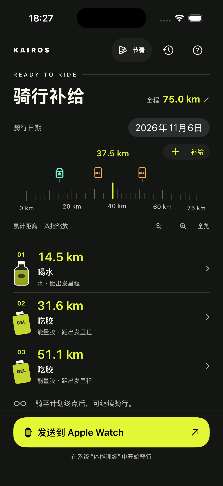
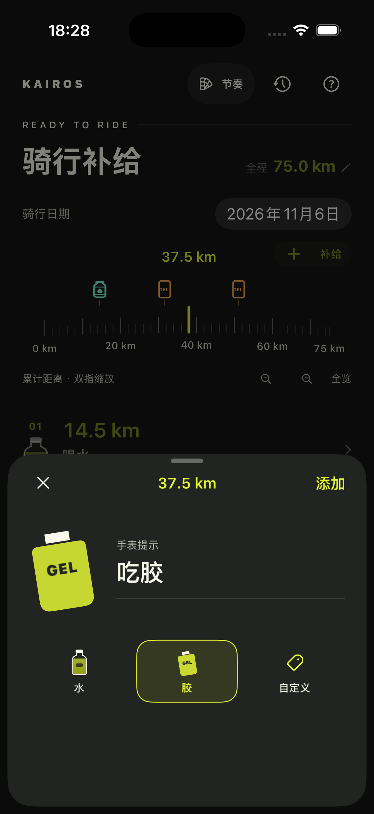
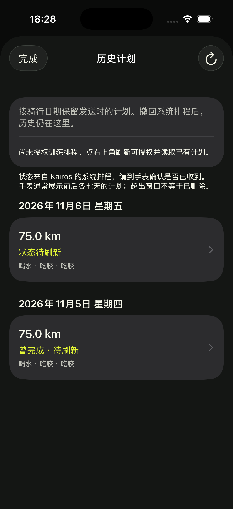

# Kairos

出发前安排好补给，骑行时交给手表。

Kairos 是一款 iPhone 骑行补给计划 App。你在手机上安排什么时候喝水、吃胶或补充其他食物，将计划发送到 Apple Watch，再用手表自带的“体能训练”开始骑行，由系统记录运动并在对应里程呈现补给提醒。

## 看看 Kairos

安排沿途补给，快速添加一站，按日期回看计划。

<table>
  <tr>
    <th>计划总览</th>
    <th>添加补给</th>
    <th>历史计划</th>
  </tr>
  <tr>
    <td></td>
    <td></td>
    <td></td>
  </tr>
</table>

*图中为示例计划。*

## 安排这一趟的补给

- **先定这趟骑多远**：设置计划距离，再手动安排每个补给点的距出发里程与提醒内容，包括 0 公里的出发补给。
- **自己决定每一站**：添加、修改或删除一个点，其他补给点保持原位。
- **看清沿途安排**：通过可缩放、左右浏览的距离尺查看整份计划，已有补给标在尺上。
- **补给不止水和胶**：水默认提醒“喝水”，能量胶默认提醒“吃胶”；也可以自定义补给名称与提醒内容。
- **选一种骑行气质**：沿途、节奏、路书、口袋补给、精密刻度，五套皮肤随心切换。
- **打开就能继续**：计划和外观偏好保存在本机，无需注册账号。
- **按日期留下计划**：选择骑行日期，发送后保留历史；可查看系统排程、完成状态，并撤回指定日期的排程。

例如，计划骑行 100 公里，沿途可以这样安排：

| 距出发里程 | 到点提醒 |
| --- | --- |
| 25 公里 | 吃第一包胶 |
| 45 公里 | 喝水 |
| 70 公里 | 吃第二包胶 |

删除 45 公里的补给点，70 公里的提醒仍在原位。距离可用米或公里输入。

最后一个补给点之后，仍可继续骑行，由你决定何时结束运动。

## 从计划到出发

1. 在 iPhone 上选择骑行日期、设置计划距离，拨动距离尺选位置，点“＋补给”填写内容并保存，核对沿途安排。
2. 点击“发送到 Apple Watch”，允许添加训练计划。
3. 在手表的“体能训练”中确认 Kairos 骑行补给计划，再手动开始。

手机显示提交完成后，仍需在手表上确认计划已收到。修改计划后需要重新发送。

历史入口在右上角。历史按骑行日期分组，同一计划同一天重发会更新当天版本，其他日期保留。撤回系统排程会保留手机历史与已完成的运动记录。系统排程状态不等于手表实时接收确认。

## 使用条件与当前状态

需要 iOS 18 或更新版本，以及配对的 Apple Watch（watchOS 11 或更新版本）。

补给提醒依据实际骑行累计距离，绕路或定位误差可能改变提醒地点；它不代表你已经完成补给。

Kairos 当前处于早期版本，Apple Watch 上的实际文字、声音和触感提醒效果仍待真机验证。
