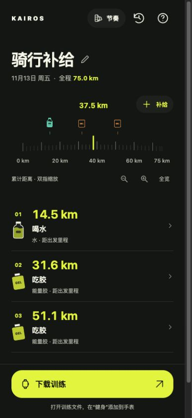
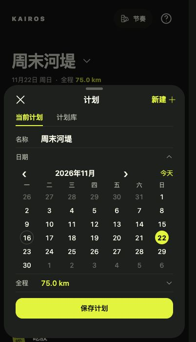
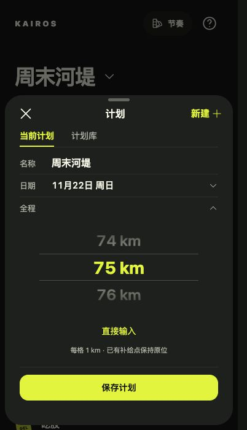

# Kairos

出发前安排好补给，骑行时交给手表。

Kairos 是一个骑行补给计划网页。出发前安排什么时候喝水、吃胶或补充其他食物，下载训练文件，在 Apple“健身”中添加到手表。骑行时用 Apple Watch 自带的“体能训练”记录运动、呈现里程提醒。

**[打开 Kairos](https://kairos-2rm.pages.dev/)** · 无需注册，也无需安装 Kairos 手机或手表 App、申请 Apple 开发者账号。

## 看看 Kairos

安排沿途补给，快速添加一站，按日期回看计划。

<table>
  <tr>
    <th>计划总览</th>
    <th>选择骑行日期</th>
    <th>设置全程</th>
  </tr>
  <tr>
    <td></td>
    <td></td>
    <td></td>
  </tr>
</table>

*图中为示例计划。*

## 安排这一趟的补给

- **先定这趟骑多远**：设置计划距离，再手动安排每个补给点的距出发里程与提醒内容，包括 0 公里的出发补给。
- **从路书开始**：可选连接自己的 iGPSPORT 中国站账号，使用密码或 App 扫码登录，搜索路书并预览路线走向、距离和爬升，缩放、拖动海拔图查看沿途起伏，确认后用于当前计划。也可继续手动设置全程。
- **自己决定每一站**：添加、修改或删除一个点，其他补给点保持原位。
- **看清沿途安排**：通过可缩放、左右浏览的距离尺查看整份计划，已有补给标在尺上。
- **补给不止水和胶**：水默认提醒“喝水”，能量胶默认提醒“吃胶”；也可以自定义补给名称与提醒内容。
- **选一种骑行气质**：沿途、节奏、路书、口袋补给、精密刻度，五套皮肤随心切换。
- **打开就能继续**：计划和外观偏好保存在本机，无需注册账号。
- **每一趟都有名字**：创建多份计划、命名、选择骑行日期，随时切换；复制一份再调整，原计划保持不变。
- **回看导出时的安排**：按骑行日期查看历史版本，再用旧版本新建计划。删除当前计划仍保留导出历史，也可撤销最近一次删除。

例如，计划骑行 100 公里，沿途可以这样安排：

| 距出发里程 | 到点提醒 |
| --- | --- |
| 25 公里 | 吃第一包胶 |
| 45 公里 | 喝水 |
| 70 公里 | 吃第二包胶 |

删除 45 公里的补给点，70 公里的提醒仍在原位。距离可用米或公里输入。

最后一个补给点之后，仍可继续骑行，由你决定何时结束运动。

## 从计划到出发

1. 用 iPhone Safari 打开 Kairos，点首页的计划标题，统一设置名称、日期和全程。公里滚轮每格 1 km，也可直接输入。回到首页拨动补给尺选位置，点“＋补给”填写内容，核对沿途安排。
2. 点击“下载训练”，从 Safari 下载列表打开训练文件，在“健身”中核对并添加到手表。也可在人像菜单的“设置与说明”中选择系统分享。
3. 在手表的“体能训练”中确认这份计划，再手动开始骑行。

可以通过 Safari 的“添加到主屏幕”保留入口。部分 iOS 主屏幕模式打开训练后可能停留在文件预览；遇到这种情况可退出后重新打开 Kairos，或改用 Safari。

点标题旁的铅笔编辑当前计划，面板里的“新建”和“计划库”用于管理多份骑行安排；右上角的历史按钮可直接查看导出历史。日期用于本机整理，不代表系统训练已排程到该日期。相同版本再次导出更新最近时间，修改后的版本另行保留。历史只记录下载请求或交给系统分享，网页无法查询或删除手表计划，也无法确认导入或运动完成。修改后需要重新下载、导入，并在手表核对。

## 使用条件与当前状态

Apple Watch 导入流程面向支持训练文件的 iPhone 与 watchOS 版本；当前体验以用户实际验证的设备组合为准。安卓浏览器可用于编排计划，尚不支持将其导入华为等手表。

路书连接为可选功能。账号密码直接发送至 iGPSPORT，Kairos 不保存密码；连接令牌保存在当前浏览器，可在路线库中断开。扫码需要 iGPSPORT App；同机扫码方式以 App 实际支持为准。

计划和外观仅保存在当前浏览器。清理浏览器数据、换浏览器或换设备后不会自动恢复。

补给提醒依据实际骑行累计距离，绕路或定位误差可能改变提醒地点；它不代表你已经完成补给。

Kairos 当前处于早期版本，骑行提醒闭环已由用户验收；具体设备上的文字、声音与触感仍以系统实际表现为准。
