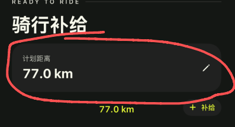
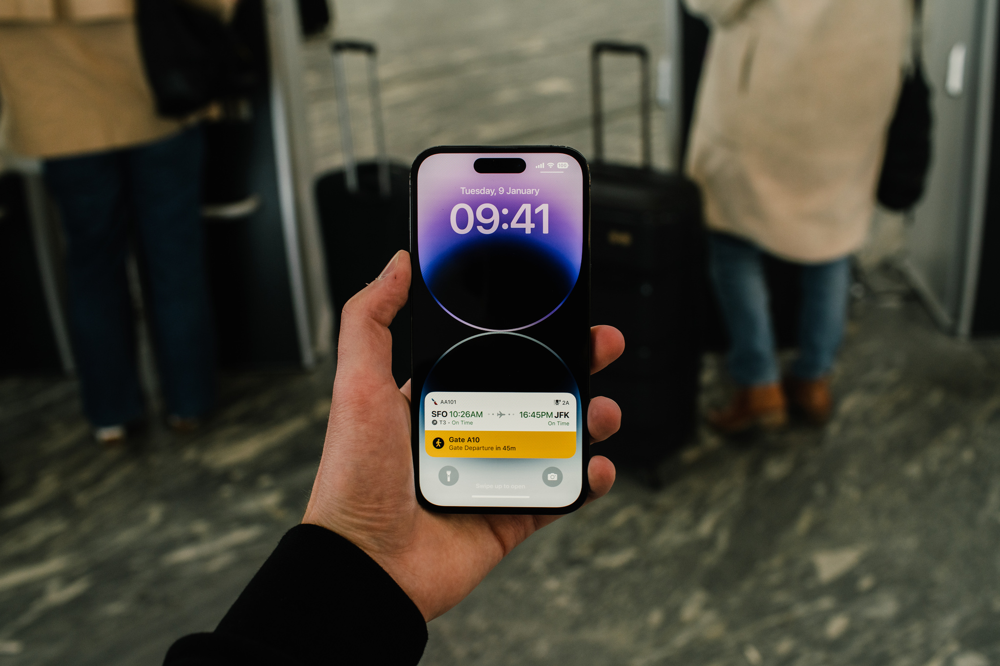
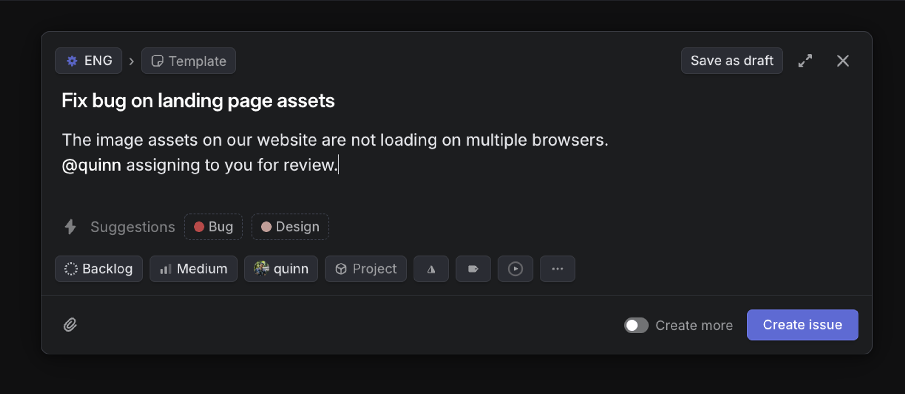
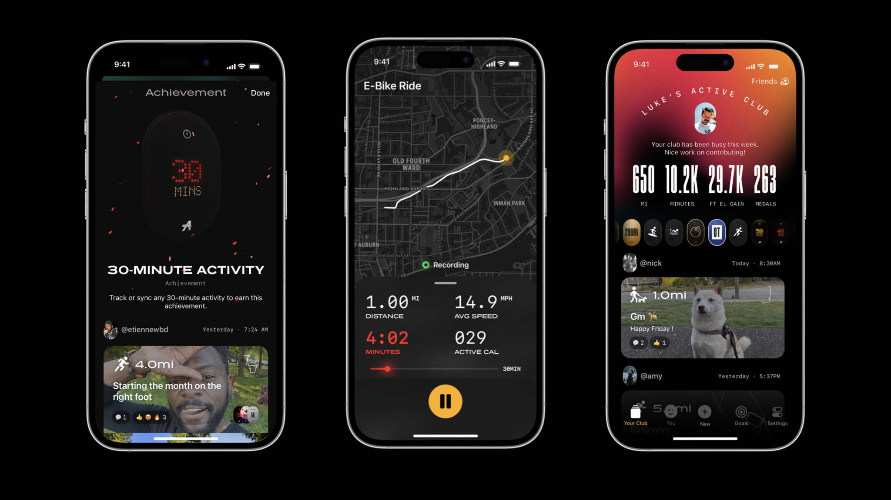
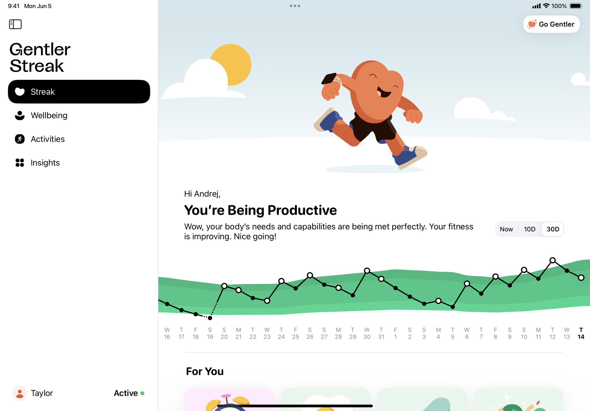
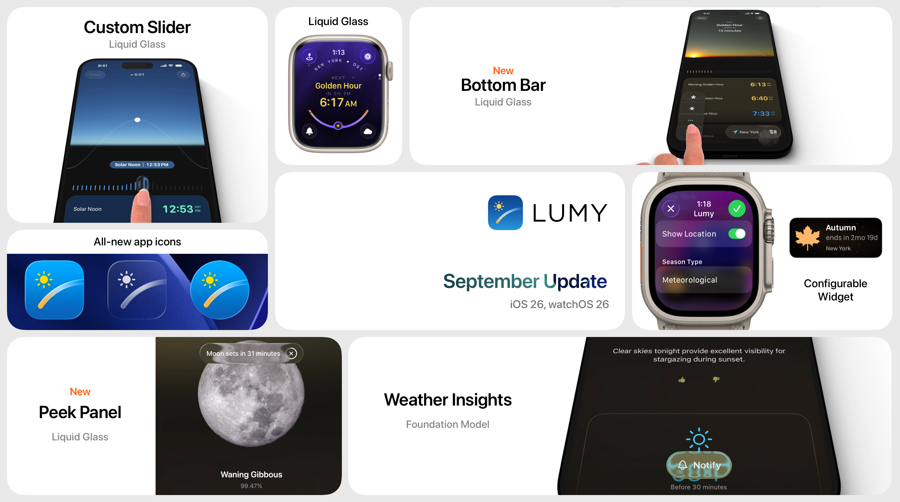
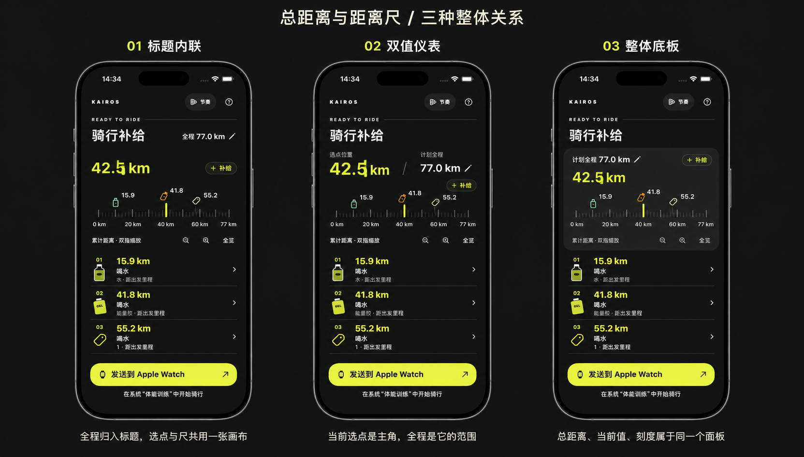
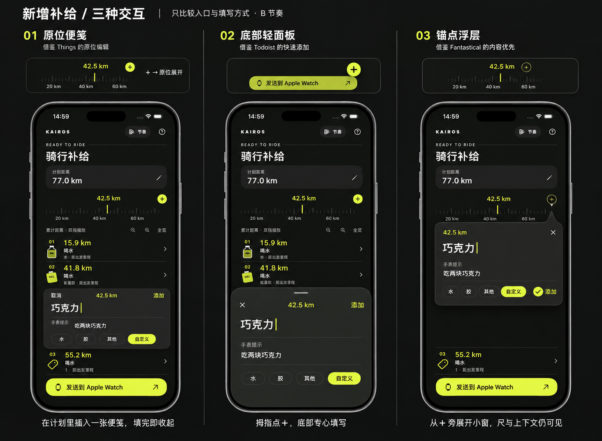
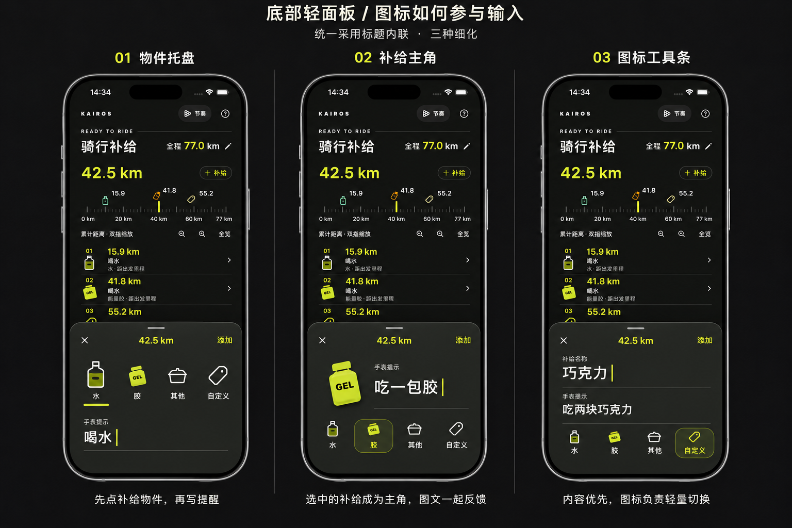

# Kairos 视觉参考与信息组织

Kairos 的计划距离、当前选点和距离尺描述的是同一趟骑行，应当读成一个整体。总距离给出范围，当前选点是正在操作的位置，尺负责把两者连接起来。用字号、对齐、留白和共同底板表达这层关系，比给每个字段单独加一张卡片更有效。

研究日期：2026-11-06。以下包含六个产品的官方展示图、逐图观察和 Kairos 的设计转译。获奖事实与视觉分析分别标明；这里的观察是对所附图片的分析，不代表原作者对 Kairos 的建议。官方图保留原貌并附来源，供设计研究，不作为 App 内素材。页面结构和已实现行为见 [界面设计记录](design.md)。

## 已确认的设计方向

上半部选择 **01 标题内联**：计划全程融入标题行，数字使用各皮肤鲜明且高对比的强调色；下方选点与距离尺共用背景。B 皮肤以荧光黄绿示范，全程数字和当前选点都采用强调色，通过字号和标签区分主次。

新增补给选择 **02 底部轻面板**，内部布局选择 **02 补给主角**，两项已实施到 App。选中物件放大，与提醒文字并排，下方以水瓶、胶包和自定义标签切换三种类型；“其他”现已归入自定义。图标同时保留文字标签与明确选中边框。以下保留三种细化稿作对照；历史稿中的四类入口不再作为当前实现要求。

## 左滑删除：把低频操作藏在条目后

参考 [Apple Mail 的左滑删除操作](https://support.apple.com/en-ie/102428)和 [Things 的手势说明](https://culturedcode.com/things/support/articles/2803582/)。Apple Mail 提供对单封邮件左滑后删除；Things 对清单条目提供左滑删除，对普通待办左滑则是选择，不能笼统声称 Things 的所有条目都用同一种删除手势。

Kairos 采用原生列表动作：平时维持轻量补给条目，向左滑后露出红色删除按钮，图标与“删除”文字共同表达动作；点按后执行，底部出现撤销。不开启一滑到底直接删除。五套皮肤共用同一套破坏性操作语义，删除按钮使用系统红色，避免 E 皮肤的红色强调色被误当成普通编辑入口。保留编辑面板内的删除入口，辅助功能可直接调用列表删除动作。

A 沿途的骑行图形改用完整的系统 `figure.outdoor.cycle`，与路线色带组合；不用截断的人物路径模拟插画。完整性和缩略图一致性优先于增加装饰细节。

## 当前画面为什么显得分离

图中红线为用户标注。标题在卡片外，总距离在卡片内，当前选点又在卡片下，三个区域各自建立了一套视觉边界。计划距离只有一个短数值，却占据了很大的容器；编辑图标独处在远端，卡片更像一个设置入口。视线读完它，还要重新寻找下方的尺。

当选点来到终点时，计划值和当前值都会显示 77.0 km。如果没有明确层级和位置关系，两个相同数字尤其容易显得重复、散乱。

本轮需要回答的是：全程如何成为尺的范围，当前选点如何成为活动值，以及修改全程的入口如何融入这一组信息。补给模型和训练记录方式没有变化。

## 六个值得借鉴的例子

### Flighty 把同一行程的信息放在同一条阅读路径上

来源：[Apple Behind the Design Flighty，2023](https://developer.apple.com/news/?id=970ncww4)；[官方原图](https://devimages-cdn.apple.com/wwdc-services/articles/images/6FCBBE04-28B7-4CBD-A9D6-230098093ABD/2048.jpeg)。这是 Apple Design Award 获奖产品的官方设计访谈配图。

**图中看哪里：** 手机下方的实时活动。出发地、时间、航线和目的地共用一条水平阅读路径；下方黄色区域突出此刻相关的登机信息。多个数值通过位置和层级成为一趟行程，而不是各自成为一张小卡片。Apple 的访谈也强调其对机场信息牌的借鉴。

**Kairos 的转译：** 把“选点位置”和“计划全程”组织为一组有主次的读数，随后直接进入距离尺。总距离不必拥有和当前选点同等的字号或独立背景。借鉴信息关系，不引入航班状态、实时活动或行程记录功能。

### Things 用对齐和间距区分内容层级

来源：[Things 官方功能页](https://culturedcode.com/things/features/)；[官方历史展示图](https://static.culturedcode.com/things/videos/2017-05-18-website-videos/2-today-iphone.png)。该图用于研究排版，不将其视为当前系统版本截图。

**图中看哪里：** Today 标题、任务标题与浅色的项目归属。任务名称和次级说明依靠共用左边线与小间距建立归属；Today 和 This Evening 的区分主要由标题、留白和细线完成。上面的日历事件共用一个背景，下面每项任务没有再各套一张卡片。

**Kairos 的转译：** 全程距离可以作为标题的次级信息，同标题共用一条基线。选点读数与尺留在同一张背景上，组内间距小于组间间距。这样可以减少容器，同时保留修改全程的文字和图标入口。

### Linear 让内容先于属性出现

来源：[Linear Issues 官方文档](https://linear.app/docs/creating-issues)；[官方原图](https://webassets.linear.app/images/ornj730p/production/25ae979891503f4780b6e837aaa71b5027c67281-1224x534.png?auto=format&dpr=2&q=95&w=1440)。此图是桌面面板，借鉴其层级，不直接搬用尺寸。

**图中看哪里：** 主标题和描述是面板里的内容，状态、优先级、项目等属性集中在下方。不同控件有不同的视觉重量，但整个面板有统一边界，没有给标题、描述和每一项属性再套完整的独立卡片。

**Kairos 的转译：** 内容层与操作层分开。计划区域只保留当前选点、全程范围及尺的操作；新增补给时，名称与手表提示通过字号和标签区分。容器采用底部轻面板，选中物件与输入并排，小图标条负责类型切换。

### Any Distance 把数值和控件组织成一个仪表

来源：[Apple Behind the Design Any Distance，2023](https://developer.apple.com/news/?id=uiiopcl8)；[官方原图](https://devimages-cdn.apple.com/wwdc-services/articles/images/F5115418-BDC7-428D-AEB5-5E3A9ABD691A/2048.jpeg)。这是 Apple Design Award 获奖产品的官方设计访谈配图。

**图中看哪里：** 中间手机的下半部。距离、速度、分钟等数据有统一的数字风格、单位处理和排列；红色时间值与下面的时间范围相呼应，多个读数共用一个底板。右侧手机的大数字和下面的小单位也有清楚主次。

**Kairos 的转译：** 大数字、单位和范围标签采用统一的基线。活动选点可以突出，总距离则缩为范围说明。借用数字的秩序与操作归属，不搬入速度、热量、运动记录或社交内容。

### Gentler Streak 让解释与图形连续阅读

来源：[Apple Behind the Design Gentler Streak，2024](https://developer.apple.com/news/?id=3m0ht22s)；[官方原图](https://devimages-cdn.apple.com/wwdc-services/articles/images/1D022CE8-F96A-4E5F-954F-FFF1B4B32BB5/2048.jpeg)。该产品获 2024 Apple Design Award 社会影响奖；图中为 iPad 布局。

**图中看哪里：** 右侧从解释性标题到绿色活动路径的连续区域。文字、时间范围选择和图形共用一张画布，靠对齐、间距和形状延续阅读；没有在解释文本与图之间再插入一张无关的设置卡。

**Kairos 的转译：** 标题、范围说明、选点和尺应当顺着一次视线移动被读懂。可以让尺直接承接上方文字，也可以让它们共享同一个底板。这里只借鉴连续性，不复制插画、健康指标或 iPad 的宽布局。

### Lumy 把选择位置和对应信息绑定起来

来源：[Lumy 官网](https://lumy.app/)；[官方展示图](https://lumy.app/images/lumy_new_2025.png)。

**图中看哪里：** 展示图左上角的手机。场景、时间选择尺和所选时刻的文字属于同一条操作路径，用户能看出“拨动这个控件，会改变下面这组信息”。图中的自定义滑尺是观察重点，其他平台示意不是 Kairos 的实现要求。

**Kairos 的转译：** 当前选点、尺和在此位置新增补给的入口放在相邻区域，并让反馈具有一致的视觉归属。总距离作为这把尺的范围出现。借鉴控件与信息的绑定关系，不引入太阳曲线、位置权限或新的底部导航。

## Kairos 的组织规则

| 关系 | 可执行的设计约束 |
| --- | --- |
| 当前选点与计划全程 | 分别表示活动位置与范围，始终有可区分的标签。不能写成已骑行里程或完成百分比。 |
| 主次数字 | 当前选点使用主题强调色和较大字号；总距离作为上下文，编辑入口紧邻它。单位在基线上配合数字，不争夺注意力。 |
| 共同归属 | 无卡片时靠对齐和间距分组；使用底板时让相关读数、尺和操作共用它，不在其中嵌套独立卡片。 |
| 间距 | 同一组内可从 8–12 pt 的节奏起步，组间约 24 pt；这些是候选设计起点，实施时随字号和真实设备调整。 |
| 距离尺 | 只有一套刻度；高亮的是实际刻度线。保留自适应整里程标签、0 位置、精确终点和已有补给标记。 |
| 颜色 | 颜色表达焦点、类型或主操作，不给每个字段分配一种无关颜色；对比度须与各皮肤背景一起检查。 |
| 不相关区域 | 对比上半部时，补给列表、发送区、数据和交互逻辑保持一致，避免把整体换风格误认为问题已解决。 |

## 上半部方案对比

以下为 imagegen 生成的 Kairos 设计提案，不是参考 App 原图，也尚未写入 App。三版使用同一份示例数据：计划全程 77.0 km、选点 42.5 km，以及相同补给列表。

| 方案 | 如何建立整体感 | 取舍与后续核对 |
| --- | --- | --- |
| 01 标题内联 | 全程归入标题行；活动读数与尺共用背景，依靠排版而非容器分组。 | 已选。数字改用鲜明主题强调色；窄屏和大字号时允许自然换行，保留编辑入口。 |
| 02 双值仪表 | 当前选点和计划全程组成一组有主次的数值，尺紧随其下。 | 保留为研究对照。标签须避免斜线被误读为骑行完成进度。 |
| 03 整体底板 | 全程、当前值、尺和尺的操作只共用一个底板。 | 整体边界最明确，改动也容易理解；需要控制底板重量和高度，避免变成新的巨大卡片。 |

用户已选择 01，并要求全程数字随皮肤使用鲜艳、高对比的颜色。上方历史对比图中的白色全程数字，由下面的新稿修正。02 与 03 保留为研究对照，不作为实施方向；“＋补给”的形态单独细化。

### 新增补给的相关参考提案

这张图同样是 Kairos 的生成提案。01 借鉴 [Things 的原位插入与按需展开](https://culturedcode.com/things/features/)，02 借鉴 [Todoist Quick Add](https://www.todoist.com/help/todoist/features/use-task-quick-add-in-todoist-va4Lhpzz)，03 将 [Fantastical 的内容优先与详细字段按需显示](https://flexibits.com/fantastical-ios/help/adding-events-and-tasks)转译为锚点浮层；不声称原 App 提供同样的小窗。容器已选 02 底部轻面板，其他两种保留作对照。字段含义和已有计划不因外观变化而合并或重算。

### 底部轻面板中的图标与输入

三版共用已经确认的标题内联、B 皮肤亮色数字及底部轻面板，仅比较图标如何参与输入。水瓶与 GEL 胶包沿用现有补给物件的视觉方向；图标不是装饰，而是可点击的类型选择。普通类型只填手表提示，自定义另有补给名称。

| 细化方案 | 图标与文字的关系 | 适合比较的重点 |
| --- | --- | --- |
| 01 物件托盘 | 四种物件以相近尺寸横排，图标下保留文字；选中用强调色和短下划线表达，下方填写提醒。 | 保留作对照，未选。 |
| 02 补给主角 | 当前类型放大，与提醒并排；下方以小图标和文字切换类型。图中以胶包示范。 | 已选并实施。复用原生补给物件和局部摆动；小选择条用边框与字重表达选中。 |
| 03 图标工具条 | 内容先出现，图标与类型文字收在下方工具条。图中以自定义名称和独立手表提示示范。 | 文字空间最充裕，长名称更从容；物件感较弱，但仍保留直观的图标入口。 |

用户最终选择 02 补给主角。所有类型都保留文字与非颜色的选中标识。自定义的名称和手表提示不合并、不自动推断，切换类型不清空已输入内容。其他皮肤采用各自强调色，不统一套用 B 的黄绿色。

该图由内置 imagegen 生成，[本次完整提示词](assets/design-references/icon-sheet-proposals.prompt.txt)随图保存。实现复用现有 SwiftUI 物件图形与原生底部面板；静态稿不作为系统键盘和面板尺寸的逐像素规范。

## 后续比较方式

按已确认的标题内联与补给主角方案检查大字号、修改全程的可发现性、拨尺时的读数关联，以及键盘出现时新增界面的稳定性。用同一份数据比较普通位置、0 位置和终点位置；当当前值等于全程时，也应能看出两者的语义。静态图用于定方向，动态手感以原生实现和真机为准。

候选图使用内置 imagegen 生成，[标题候选的完整生成提示词](assets/design-references/header-proposals.prompt.txt)随图保留。官方截图版权归原作者，来源页面和原图链接已在各节对应标注。当前实现与验证记录见 [界面设计](design.md)。
