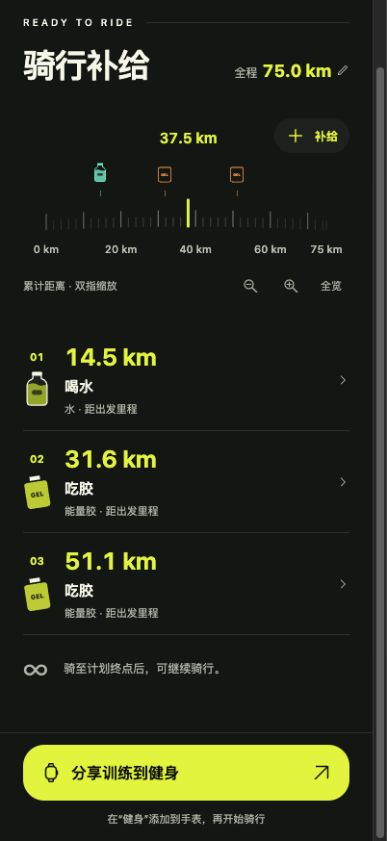
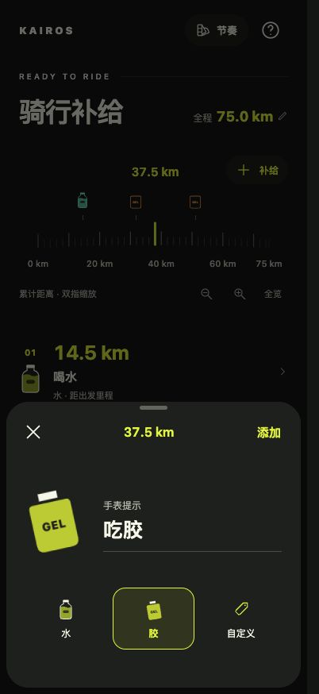
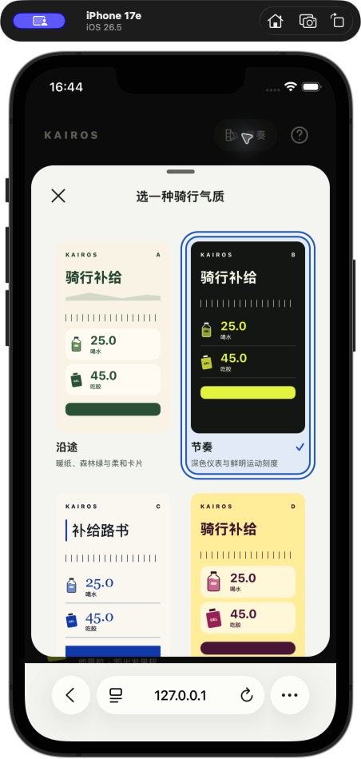
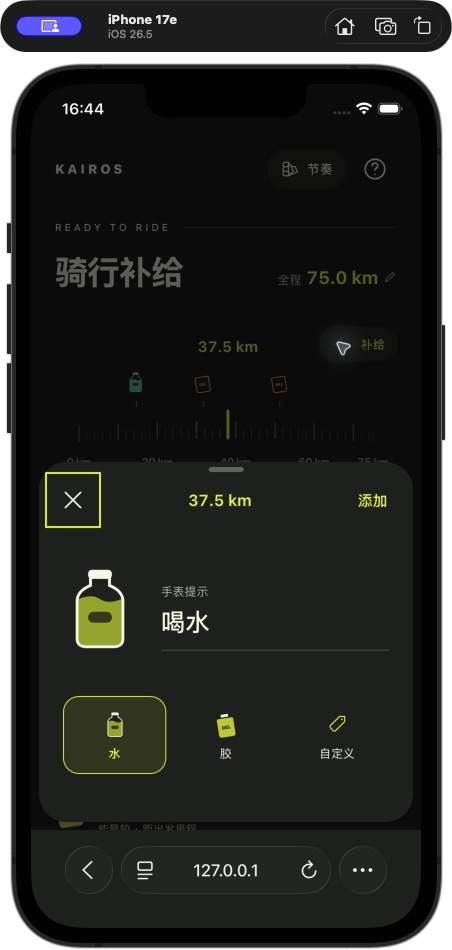

# Kairos 界面设计

带官方原图、逐图观察及局部候选 UI 的长期参考，见 [视觉参考与信息组织](design-references.md)。该文档把参考来源与 Kairos 自己的生成提案分开标注。

当前实现采用已确认的标题内联与「补给主角」底部轻面板：全程数字使用鲜明且高对比的皮肤强调色；选中补给物件放大，与提醒并排，下方用小图标和文字切换类型。候选稿与参考依据见上述文档。

## 网页：对齐 B「节奏」（2026-11-10）

沿用现有 App，而不是重新设计：背景 `#141614`、正文 `#F7F8EB`、强调色 `#E4F735`、面板 `#212420`；补给物件复用 `FuelArtwork.swift` 的瓶身、胶袋和标签几何。首页保留标题内联全程、单层距离尺、独立点位列表和固定主操作；网页没有系统排程 API，所以省去原生历史／日期。此阶段仅移植 B；五套换肤入口已在下述修复中补齐。

- 单层尺直接高亮实际刻度，附近随滑动起伏；主刻度按可见范围选择 1/2/5 倍数，保留非整间隔的终点标签。已有水／胶为薄荷青和暖橙，密集点聚合，可点击定位或放大。程序定位和缩放保持精确游标，避免浏览器整数像素取整改变公里读数。
- 底部「补给主角」面板固定带入打开时的游标位置，默认喝水／吃胶，手改文案后切类型不覆盖；自定义另填名称。已有点可精确修改米／公里。取消不保存，键盘出现时调整面板并冻结背景滚动。
- 列表只按稳定 ID 更新，入场摇动、倒空与飞走仅作用于目标物件。左滑露出红色删除区，需要点按删除，随后可撤销。减少动态效果关闭装饰运动；网页不宣传原生触感。
- 主操作为「下载训练」，采用用户真机反馈最好的原备用下载路径（本机 File → Blob URL → download）。保留手表图标与右上箭头；分享、打开方式对照、预览与兼容性信息收进帮助，不将下载或分享结束显示为手表接收成功。

以下为 402×874 浏览器实际渲染截图（不是生成 UI 图）；Safari 模拟器的键盘及系统分享见网页验证文档。

| 网页首页 | 补给主角面板 |
| --- | --- |
|  |  |

## 网页交互修复与五套皮肤（2026-11-11）

- 全程编辑打开后聚焦输入框，光标落在现有数字末尾，不主动全选。
- 修复 Safari 中「＋补给」无响应：距离尺根节点的 `touchend` 曾无条件重绘；现在只有实际结束双指缩放时才执行该分支，避免普通按钮点按期间重绘干扰最终 `click`。
- 顶部皮肤标记改成可操作入口，提供 A 沿途、B 节奏、C 路书、D 口袋补给、E 精密刻度。沿用原生的配色、字体与卡片方向；缩略图展示物件、卡片和排版差异，不只是色块。没有移植 A 的旧自行车插画。
- 选择面板固定中性浅底、深色说明和蓝色选中状态；页面、编辑表单、刻度与补给物件使用当前皮肤变量，浅色表单的删除和占位文字也适配。
- 皮肤独立保存在 `kairos.web.theme.v1`，切换不写计划草稿；读取失败或未知皮肤回落 B，不覆盖原数据。支持方向键、Home/End 和选中状态。

模拟器 Safari 实际截图；面板可滚动查看下面的皮肤：

| 五套皮肤入口 | 「＋补给」可打开面板 |
| --- | --- |
|  |  |

验证：36 项 Node 测试通过；402×874 浏览器逐一切换五套皮肤，刷新保留选择，原计划 75 km、14.5／31.6／51.1 km 三点及文案不变；临时添加 37.5 km 水点后只删除该点，刷新恢复原三点。iPhone 17e／iOS 26.5 模拟器 Safari 检查输入光标、换肤、刷新保留皮肤及新增入口。未据模拟器认定真实手机或独立 PWA 全部通过；本轮没有提交部署。

## 应用图标（2026-11-06）

补齐此前缺失的主 AppIcon：深绿底、暖白 K 字标、黄绿色上斜笔，使用自有几何路径，固定品牌标记与用户选择的皮肤分开。矢量源为 [app-icon.svg](assets/app-icon.svg)，应用资源位于 `Kairos/Assets.xcassets/AppIcon.appiconset`，PNG 为 1024×1024、不透明、不预裁圆角，由系统应用方形或圆形遮罩。

Debug／Release 均指定 `ASSETCATALOG_COMPILER_APPICON_NAME = AppIcon`，保留用户现有签名团队。两种 SDK 构建通过；iPhone 安装包已包含 `CFBundlePrimaryIcon` 的 `AppIcon` 与图标文件条目，iPhone 17 / iOS 26.5 模拟器桌面已确认显示新标记。

Apple 在 [WWDC23](https://developer.apple.com/videos/play/wwdc2023/10016/) 说明，WorkoutKit 的 App 专属排程入口使用 App 图标和名称；这里补的是 App 标识，不改变系统训练分段的箭头标记。真实手表是否已刷新图标仍需在更新 iPhone App 后核对，不将桌面图标验证当成 Watch 同步验证。

## 当前：按日期的历史与系统排程管理（2026-11-06）

- 首页标题下增加骑行日期，默认当天；右上角历史入口按骑行日期分组。发送后保存该计划当日的快照，同计划同日重发更新当天版本，其他日期独立保留。同日已完成计划再发送使用新 ID，保留上一次完成记录。
- 历史详情对照累计补给位置与实际导出的系统分段。可刷新本 App 的系统排程和完成标志，撤回指定 UUID＋日期的计划；撤回保留本地历史和运动记录。只保存／读取 WorkoutKit 的计划元数据，不读取 HealthKit 运动统计。
- 系统排程中不等于真实手表此刻已收到。查询失败显示待刷新，曾完成／曾撤回仅表示过去记录；排程缺项不自动标成已删除。Apple 所述前后七天是手表展示窗口，不等于历史保存期限或自动清理规则。
- 修正手机一位小数与实际发送距离不同的问题。公里量级以 0.1 km 保存和发送，不足一公里以 0.1 m 保存；旧存档读取保留原数据，成功重发后保存规范距离。取整重合时要求用户处理，不自动合并。
- 系统分段名加入累计位置。开头仅为骑行，不自动新增补给提醒；最后补给后保留骑到总距离的尾段，到终点才显示“计划完成，继续骑行”并进入开放段。补给恰在终点时合并补给与完成文案。
- 这次仅做本地实现与验证，不修改用户的真实 Watch 排程；更新手机 App 后需重发才能替换旧版分段。

## 上一轮：全皮肤检查、原生左滑删除与三类补给（2026-11-06）

- A 沿途的手绘人物头部超出了 74 点容器，且按页面宽度画车架导致比例不稳定；替换为完整的 SF Symbol `figure.outdoor.cycle`，保留纸色与路线带。主页面和皮肤缩略图共用该图形。A–E 五套实际主页面均已在模拟器逐套查看。
- 补给条目使用原生 `List` 和 `swipeActions`：左滑露出红色垃圾桶／删除文字，点按后沿用物件删除反馈及撤销；关闭整段滑动直接删除。发送时和正在删除的点禁用重复删除。原生列表管理横滑与纵向滚动的冲突，距离尺按钮单独响应。
- 新增只保留水／胶／自定义。水默认“喝水”，胶默认“吃胶”；打开标准类型时不自动弹键盘，可以直接添加。未手改时默认提示随类型切换，手改后保留文字。自定义仍有名称和提醒两个字段。
- 旧 `other` 和缺少类型的存档读取为自定义，空名称用“补给”，保留原有 ID、精确距离与提醒，不按提醒文字猜补给类型。已有自定义的空名称仍视为未完成。编码统一保存为三类，老的分段里程迁移继续保留。
- 本轮范围不包含重画全部皮肤或改动 WorkoutKit 导出。计划中其他点的里程、提示与用户当前皮肤必须保留。
- 验收：29 项核心测试、两种 SDK 编译和格式检查通过；新增文案切换、手改保留、通过列表辅助功能动作删除、撤销、清理临时点与重启恢复已验证。自动化未稳定触发的左滑展开由用户在模拟器人工确认“能正常滑出”。真实触感、极大字号及 Watch 骑行仍待真机。

## 上一轮：标题内联与补给主角面板（2026-11-06）

- 去掉独立的计划距离卡片，全程与铅笔入口融入标题行。宽度不足时回落为上下排列；全程和当前读数使用各皮肤的鲜明强调色。
- 「＋补给」打开原生底部轻面板，位置固定取打开时的读数。大补给物件与手表提示并排，下面的三个小物件切换水／胶／自定义；选中有边框、字重和可访问状态。
- 水默认“喝水”，胶默认“吃胶”，自定义另有名称字段。尚未手改时默认提醒跟随类型，手改后切换类型不覆盖输入；类型反馈仅驱动大物件，保存后仅驱动新点的反馈。取消和下滑关闭不保存。
- 面板收起后再写入计划，背景列表与发送区保持布局；没有改动计划模型、已有编辑面板、距离尺或 WorkoutKit 转换。
- iPhone 17 Pro / iOS 26.5 模拟器验收：B 节奏、C 路书的标题与面板；软键盘展开；空提醒与空自定义名称禁用添加；类型来回切换保留名称和提醒；取消不保存。临时新增 38.5 km 水点与 0 m 自定义点，重开编辑核对成功，随后只删除这两个测试点。重启后原有 77 km 全程与三个补给点保留，恢复 B 皮肤。
- 28 项核心测试、iPhone 与模拟器 SDK 编译、Swift 格式检查通过。极大字号和真实触感仍需真 iPhone 检查；这次没有执行 Apple Watch 骑行实验。

## 参考选择

以下按 Kairos 相关性选择 10 个设计参考，不是客观的全球前十排名。设计奖、入围和编辑推荐是可核查事实；“借鉴模块”是对公开界面和设计介绍的分析，不代表原产品支持骑行补给。

| 参考 App | 公开评价依据 | 与 Kairos 相近的模块 / 可借鉴点 |
| --- | --- | --- |
| Gentler Streak | [2024 Apple Design Award，Social Impact](https://developer.apple.com/design/awards/2024/)；[设计访谈](https://developer.apple.com/news/?id=3m0ht22s) | 运动健康；柔和视觉、数据层级、友好的指引。主要参考。 |
| Slopes | [2022 Apple Design Award，Interaction](https://developer.apple.com/design/awards/2022/) | 户外运动与手表；关键数字优先、复杂信息分层。 |
| AllTrails | [2023 iPhone App of the Year](https://www.apple.com/uk/newsroom/2023/11/apple-unveils-app-store-award-winners-the-best-apps-and-games-of-2023/) | 户外规划；自然配色、出发前的信息组织。 |
| Any Distance | [2023 Apple Design Award，Visuals and Graphics](https://developer.apple.com/design/awards/2023/)；[设计访谈](https://developer.apple.com/news/?id=uiiopcl8) | 运动距离；数字、单位、SF Symbols 的主次关系。 |
| Waterllama | [2022 Apple Design Award 入围，Delight and Fun](https://developer.apple.com/design/awards/2022/)；[官方界面](https://waterllama.com/) | 补水；少量输入、清楚的单位和主操作。 |
| Flighty | [2023 Apple Design Award，Interaction](https://developer.apple.com/design/awards/2023/)；[设计访谈](https://developer.apple.com/news/?id=970ncww4) | 行程节点；突出接下来要做的事。主要参考。 |
| Things 3 | [官方设计评价与两次 Apple Design Award](https://culturedcode.com/things/) | 列表编辑；留白、低干扰控件、明确的添加入口。主要参考。 |
| Crouton | [2024 Apple Design Award，Interaction](https://developer.apple.com/design/awards/2024/)；[设计访谈](https://developer.apple.com/news/?id=9x75y43e) | 计划与分步执行；把编辑和执行顺序组织清楚。 |
| Streaks | [Apple Design Award 获奖及官方界面](https://streaks.app/) | 健康习惯与自定义项目；少而明确的操作、容易辨认的状态。 |
| Lumy | [2025 Apple Design Award 入围，Delight and Fun](https://developer.apple.com/design/awards/2025/)；[官方界面](https://lumy.app/) | 户外时机规划、手表；克制配色和易扫读的信息。 |

主要组合是 **Gentler Streak 的运动健康气质 + Flighty 的节点顺序 + Things 的轻量编辑**。不复制品牌、插画、截图或专有图形，不移植社区、地图或运动记录功能。

## 初版视觉与交互规则（历史）

- 暖白背景、森林绿主操作、浅绿辅助区域，深色模式随系统适配。状态不只靠颜色表达。
- 概览显示最后补给里程和补给点数量；不是路线全长，不显示未经输入的路线、爬升、热量或补给建议。
- 编辑与里程预览分开，避免一页重复一长串内容。顺序号对应输入顺序。
- “本段距离”“到点提醒”始终显示标签，示例只是占位；显式提供删除入口。
- 底部固定一个发送主操作，未完成原因紧邻按钮。空白分段不允许发送，不自动填入测试数据。
- 使用条件和启动步骤收进说明面板。提交状态仍区分本机排程与真实手表同步。
- 使用原生 SwiftUI、SF Symbols、系统字体，保留 Dynamic Type、键盘完成按钮和 VoiceOver 标签。没有装饰性动效。

以上描述初版的浅绿界面，现由下述五套原生皮肤替代。

## Issue #1：五套原生皮肤

| 皮肤 | 排版与图形 |
| --- | --- |
| A 沿途 | 暖纸色、森林绿、圆润字体、原创骑行矢量插画与柔和点位背景 |
| B 节奏 | 炭黑、荧光黄、紧凑运动字体、仪表式刻度、平面分隔线 |
| C 路书 | 蓝色墨迹、衬线数字、页边细线、路书式条目 |
| D 口袋补给 | 奶油黄与深紫、紫色水瓶、独立补给物件、圆润条目 |
| E 精密刻度 | 冷灰白、朱红、系统字体、精确对齐与细分隔线 |

五套皮肤共用核心模型、编辑和排程。外观与触感开关单独保存，切换不改计划。F 不提供给用户。当前是概念方向的原生实现，视觉细节仍需用户审阅，不声称与生成稿像素一致。

- 首页为累计里程概览与紧凑列表，不显示全局补给点计数；尺右上角“＋补给”同页展开输入，已有条目的编辑仍通过列表打开面板。
- 原生 UIScrollView 承接惯性与边界回弹；独立刻度绘制在缩放时保持字号，使用单层刻度，高亮中心焦点，不叠加第二排点位刻度。双指缩放保留手势锚点，另有放大、缩小、全览按钮。
- 首页浏览不移动已有点；新增位置取打开底部面板时的尺读数，点击已有标记联动列表。修改已有点仍进入编辑页，数值输入可切换米/公里。
- 刻度与经过节点分别使用 selection / soft impact 反馈，快速滚动限频；系统决定实际播放，用户可关闭。
- 补给类型为水、胶、其他、自定义；自定义名称与手表提醒文案独立，不按任意文案猜类型。旧存档明确按“其他”读取，保留 UUID、文案及迁移后的累计位置。
- 保存/删除在编辑面板收起后执行，让点位入场、瓶身摆动、水面变化或退出可见；删除只移除该点，其他点位保持原里程，可撤销最近一次删除。动画中的水位不代表实际摄入。
- 支持减弱动态效果，正文使用系统动态字号。超大字号、真实手势和触感尚未完整验收。

### 本轮验证

- 21 项核心行为测试通过：新增旧 JSON 兼容、自定义补给往返、名称校验和 WorkoutKit 文案保持检查。
- iPhoneOS / iPhoneSimulator SDK Debug 无签名编译与严格格式检查通过；未更改签名配置。
- iPhone 17 Pro / iOS 26.5 模拟器逐一检查五套首页和皮肤选择；重启保持皮肤与原计划。
- 原计划 50/100 米、Gel/Water 保留；第二点在模拟器显式改为水。临时新增 250 米、自定义 Banana、Eat banana 后累计 400 米，重开编辑正确回读，切换 0.25 公里后保存不改实际距离；该临时点已删除。
- 模拟器验证缩放按钮改变刻度比例且不改里程，删除/撤销恢复原点位。双指缩放、滚动阻尼、真实触感、密集数据和极大字号仍需真机/专项验收，不据编译成功认定通过。

## 验证记录（2026-11-06）

### 同页新增、主题焦点与完整里程标注（历史）

- 已实现上一轮确认的同页新增流程：尺右上角小入口 → 当前位置自动带入 → 类型与内容 → 勾选保存。自定义名称保留独立字段；取消不修改计划。去掉首页补给点计数和列表后的大添加按钮，保留现有标题、计划卡片、条目和发送区。
- 读数和列表距离显示一位小数，保存数据不舍入。主刻度按总距离、可见范围及缩放选择 1/2/5 的十进制倍数；85 公里全览约 20 公里一格，放大后细分。非整主刻度的终点也明确标出实际距离，相邻标签过近时优先保留终点。
- 焦点使用主题鲜明色；B 为荧光黄绿，水/胶标记分别为薄荷青、暖橙。尺上保留一套刻度，邻近刻度在拖动时局部起伏，松手回落，不添加独立指针。密集标记以数量聚合。
- 0 公里点允许创建、校验、保存和发送；WorkoutKit 初始分段直接使用出发补给文案，不生成 0 米目标。总计划距离仍为正数。
- 入口和表单的下一轮替代方案仅做了三种预览：原位便笺、底部轻面板、锚点浮层；尚未套入代码，也未引入自然语言解析或字段自动合并。
- 本轮 28 项核心测试覆盖刻度间隔、同页草稿校验、出发点排序/重复/保存与 WorkoutKit 正距离或开放目标。实际声音、触感和续航仍待真机。

### 计划总距离与固定里程点

- 输入顺序调整为：设置计划总距离 → 添加各点的距出发里程/补给类型/提醒。总距离独立展示并可编辑，不再以最后补给点代替终点。
- 点位按距出发里程排序。新增、移动或删除某点不会改变其他点的里程；同一位置的补给合并为一条提醒，超出总距离的点不能保存。
- 修改总距离不缩放点位。若短于已有最远点，明确要求先调整该点或增加总距离。
- 编辑尺覆盖整个计划距离，首页仍只浏览；距离输入支持米/公里。只保留一套刻度，直接高亮焦点附近的实际刻度线，读数跟随该线；不再叠加独立固定指针和读数胶囊，高亮使用皮肤无关的黑白高对比。
- 旧分段计划累加迁移，保留原身份与文案；单独提示确认总距离。旧数据若不完整，保留原始输入并要求手动确认，不猜后续位置。
- 验收重点：100 公里计划上的 25/45/70 公里点，删除中点后最后一个点仍在 70 公里；WorkoutKit 转换为 25/45 公里目标及开放尾段。
- 验证：先复现旧模型删除中点导致后点前移的失败用例，修复后 23 项核心行为测试通过。覆盖固定点增删改、超界/重复里程、旧分段迁移一次、无效旧草稿保留、本机保存/恢复及 WorkoutKit 距离差转换。
- iPhone 17 Pro / iOS 26.5 模拟器在独立 Bundle ID 的测试副本中输入 100 公里、25/45/70 公里三点，实际删除中点后仍显示 25/70 公里，撤销恢复 25/45/70 公里；总距离改成 60 公里被明确阻止，改成 120 公里后各点不动。单层黑白聚焦刻度已视觉检查。
- 原 App 显示原四点累计 169.9、1169.9、2169.9、3169.9 米，保留 Water/喝可乐/喝水/喝水；总距离未代填。连续触摸缩放/惯性和真实触感仍须 iPhone 验收，未发送测试计划到系统训练。

### 相机参考修正：刻度自身高亮

- 删除独立固定指针及其偏转动画、读数胶囊；选中实际刻度后直接改变这根线的颜色、粗细和高度。读数跟随该线，普通刻度降低高度与对比度，避免零刻度与焦点并排时形成两根长指针的观感。
- 保留 UIScrollView 惯性、双指缩放、缩放按钮连续动画及原有触感逻辑；首页浏览和编辑页修改距离的职责不变。
- iPhone 17 Pro / iOS 26.5 模拟器检查了节奏皮肤首页、编辑页 1.574 公里近起点状态及按钮放大后的刻度，均为一套刻度中一根高亮线，没有额外叠加指针。临时输入已取消，原 85 公里计划及 15.9259/41.7593/55.1852 公里三个点保持不变。
- 两套 iOS SDK 无签名构建、严格格式与差异空白检查通过。本次只修改绘制层，未重复运行未受影响的核心测试；真实触摸与触感仍待 iPhone 验收。

### 距离尺、独立反馈与皮肤选择器修正（前轮记录）

- 参考 [Apple 相机控制演示](https://developer.apple.com/videos/play/wwdc2025/253/)的滑动调值与状态同步方式，距离尺增加更密的细分刻度、中心读数、中心强化/边缘衰减与轻微弧线。缩放按钮通过逐帧插值连续过渡；拖动时指针轻微随速率偏转，松手后收回，减弱动态效果下抑制装饰运动。
- 新增/修改点位不再重新适配整把尺的比例或自动跳到新增点；用户主动全览时再重新适配。输入框的精确数值作为编辑尺静止时的读数，避免像素取整造成显示偏差。
- 保存和撤销去掉整页弹簧动画；每次操作生成只交给目标 UUID 的动画事件。旧点从“被触发”变为“未触发”不会重播。修改距离只移动目标点，不对其他图标播放入场反馈。
- 皮肤选择器使用固定浅色中性底与深色标题/说明；选中状态使用蓝色边框和勾选，不继承当前皮肤颜色。标题、说明对白底的计算对比度分别约 15.7:1、7.67:1。
- 五张示例缩略图分别呈现骑行插画、运动仪表、蓝墨衬线路书、补给物件与精密标尺；同一份示例计划用于比较，未作为用户数据保存。
- 模拟器检查了五张缩略图及选择 B/E 时的可读性；按顺序保存原有第一、第二点，再临时新增 20 米水点。新增前后视口中心读数保持 325.649 米，原三点累计距离/文案保持 155.8、325.7、1325.7 米及 Gel/Water/喝可乐。临时点在验收后移除，恢复用户的口袋补给皮肤。
- 核心 21 项测试通过；两套 iOS SDK 无签名编译与格式检查通过。连续触摸手势、指针动态的实际节奏和触感仍待真实 iPhone 验收；模拟器静态截图与鼠标拖动不能证明手感已达标。

### 初版检查（历史）

- 原有 18 项 Swift Package 行为测试通过，iPhoneOS / iPhoneSimulator SDK 无签名构建通过，Swift 格式检查通过。
- iPhone 17 Pro / iOS 26.5 模拟器实际检查了首页、编辑/预览切换、50/150 米累计里程、补给点添加与删除、说明面板打开/关闭、本机排程反馈。空白临时补给点出现明确原因且不能发送，删除后恢复可发送。
- 通过安装更新后的启动确认本机保存的 50/100 米、Gel/Water 和两个补给点仍在。测试临时新增项已删除。
- 修正长列表滚动时内容进入状态栏的问题：品牌栏固定在顶部安全区域，发送区固定在底部。
- 浅色/深色主操作、辅助文字和警告文字的选定前景/背景配色，经相对亮度计算均达到 4.5:1；深色模式及超大字号尚未逐项进行模拟器视觉验收，不将配色计算等同于完整无障碍验收。
- 没有真实手表同步、骑行分段显示、声音、触感或续航验证，没有提交或推送代码。
