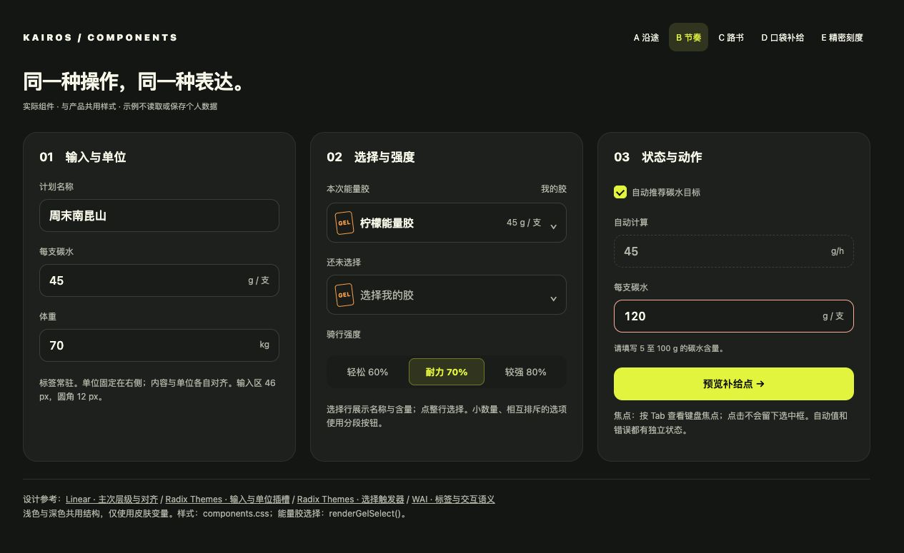
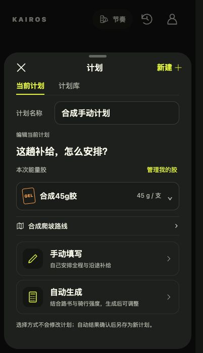
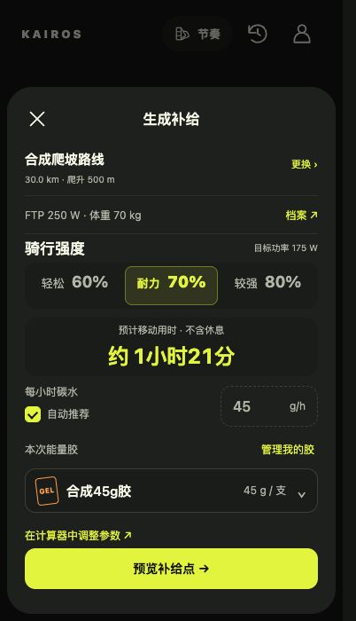
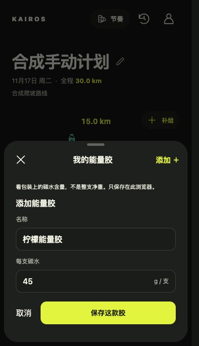
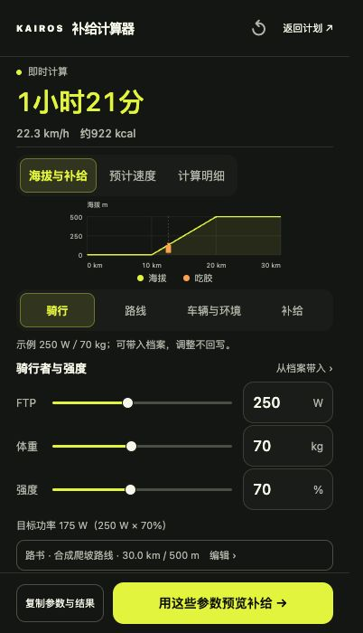
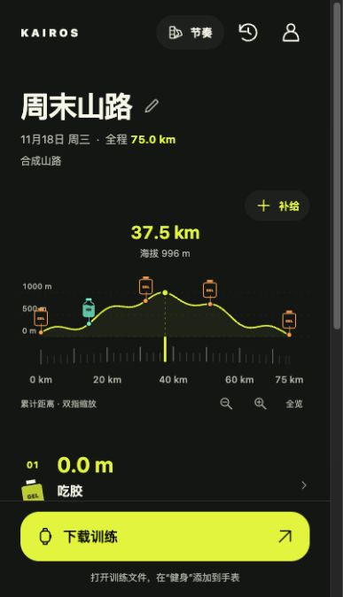
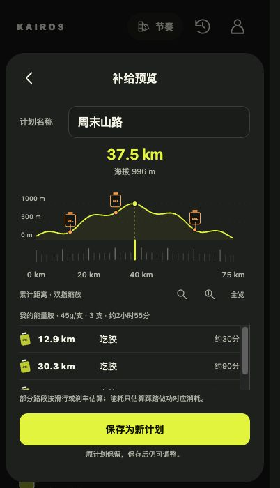
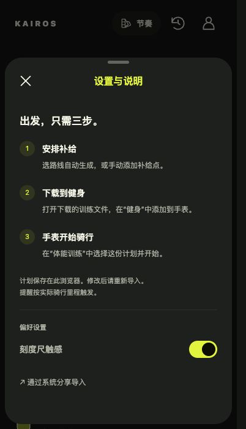

# Web 组件手册

同一种操作复用同一种组件。页面只负责排列组件，不另造输入框、选择框或选中状态。此文档与 `web/components.css` 是表单视觉的统一依据；[可操作组件页](../web/test/components.html) 直接使用产品样式和 `renderGelSelect()`，不读取个人数据，也不随产品发布。

本地预览：在仓库执行 `rtk proxy python3 -m http.server 8845 --directory web`，打开 `http://localhost:8845/test/components.html`。已占用端口时沿用现有服务。

## 参考与明确取舍

| 组件／规则 | 设计参考 | Kairos 采用的做法 |
| --- | --- | --- |
| 层级、分组与对齐 | [Linear：A calmer interface](https://linear.app/now/behind-the-latest-design-refresh) | 内容和预计用时突出，标签、单位、管理动作退后；用间距组织相关信息，避免每层套卡片。强度与目标功率放在同一行。 |
| 文本框、数值与单位 | [Radix Themes：Text Field](https://www.radix-ui.com/themes/docs/components/text-field) | 统一容器，单位是固定插槽；两类输入共享尺寸、圆角、背景和焦点边框。 |
| 能量胶选择 | [Radix Themes：Select](https://www.radix-ui.com/themes/docs/components/select) | 整行触发，胶标识／名称／每支碳水／箭头固定排列；管理放标签行右侧，不挤占选中内容。 |
| 标签与操作语义 | [WAI：Labeling Controls](https://www.w3.org/WAI/tutorials/forms/labels/)、[Grouping Controls](https://www.w3.org/WAI/tutorials/forms/grouping/) | 保留真实 label、input、select、checkbox；装饰内容不重复进入辅助技术；键盘焦点可见。 |
| 滑杆加精确输入 | [Tweakpane：Input bindings](https://tweakpane.github.io/docs/input-bindings/) | 滑杆与数值双向同步；右侧数字使用同一个单位框。 |

参考的是结构、层级和状态，实际使用原生 HTML／CSS／ES 模块，不引入 React 或整套 UI 框架。能量胶展示层覆盖一个真实 select；弹出的选项遵循平台选择器，并非复制 Radix 菜单，保留 iPhone 选择体验和桌面键盘行为。



## 共同尺寸和颜色

- 标准输入高 46 px，数值密集区 44 px；圆角 12 px，左右内边距 13 px。
- 可编辑内容不小于 16 px；标签、单位通常 12 px，选择名称 15 px，关键结果更大。
- 同组字段间距 14 px、标签与控件 8 px。紧凑手机可以减小组间距，不能缩小输入文字。
- `--field-fill`、`--field-border` 由皮肤派生；内容用 `--ink`、辅助信息用 `--muted`、焦点与选中用 `--accent`。页面不硬编码 B 的颜色。
- 默认框线安静，编辑时边框强调。键盘访问显示焦点环，指针点击不留下按钮焦点框。
- 自动值用虚线边界和弱化文字；只读值保持可读。错误须有文字，不能只变色。
- 边框、背景过渡 150 ms；遵循减少动态效果设置。

## 可复用组件

| 名称 | 实现入口 | 使用场景与约定 |
| --- | --- | --- |
| 字段与标签 | `.ui-field`、`.ui-field-heading` | 常驻标签，右侧仅放相关次操作。计划名称允许左标签、右输入的行内排列。 |
| 常规输入 | `.ui-input` | 计划名称、胶名称、模拟路段数字。示例 placeholder 不能代替标签。 |
| 带单位输入 | `.ui-value > input + small` | 碳水、重量、功率、效率等；单位固定在右侧，不让用户在数字里输单位。 |
| 能量胶选择行 | `renderGelSelect()` → `.ui-gel-select` | 计划、生成器、计算器共用。名称长时截断，系统选项保留全名；含量不被挤掉。空选择、计划快照保留原有语义。 |
| 分段选择 | `.ui-segments` | 强度、性别、计算器分组和结果视图；保留按钮／tab 语义和键盘行为，选中项用柔和强调面。 |
| 自动推荐勾选 | `.ui-check` | 真实 checkbox 和可点击标签；主题强调色与对比色勾。 |
| 主操作 | `.primary.ui-action`／`.secondary.ui-action` | 表单操作统一 46 px、12 px 圆角、14 px 字号。面板底部保持一个主操作；管理、取消、计算器入口降低视觉权重。首页下载保留较大的主操作变体。 |
| 列表与面板 | 既有 `.sheet`、`.gel-card`、`.profile-gels` | 胶列表展示名称与每支碳水；清单过长仅列表内部滚动。 |

```html
<label class="ui-field" for="amount">
  每支碳水
  <span class="ui-value">
    <input id="amount" type="number" inputmode="decimal" min="5" max="100">
    <small>g / 支</small>
  </span>
</label>
```

选胶不要自行拼接另一套控件，使用 `renderGelSelect(select, storage, snapshot)`。保留真实 select 的值和 change 事件；反复刷新不套多层容器、不累积事件。

密集模拟路段使用 `.ui-input--compact`，高度 44 px；按文字自然宽度排列的结果页签使用 `.ui-segments--content`，避免平均分栏造成中文折行。距离单位是 `.ui-unit-select`，密码显隐和搜索按钮使用 `.ui-value` 的尾部操作插槽。

## 页面组织

计划入口：名称 → 胶与路线 → 手动／自动。自动生成：路线及档案摘要 → 强度 → 用时 → 碳水目标 → 选胶 → 预览。胶配置：清单 → 名称与碳水两个字段 → 保存。计算器保留结果区与参数分组，密集数值仍用同一组件。

自动生成与计算器只安排吃胶。喝水可在主页面手动添加；旧计划、历史和手动水点不因这次修改被清除。

以下为 402×700 内容区域的实际页面，使用合成路线、档案与胶配置：

| 计划入口 | 自动生成 |
| --- | --- |
|  |  |

| 胶配置 | 计算器 |
| --- | --- |
|  |  |

## 海拔补给距离尺（Issue #21）

首页、自动生成预览与计算器的海拔视图统一使用 `DistanceRuler`（`web/ruler.mjs`、`web/ruler.css`），通过 `update(plan, profile)` 接收累计里程点位和海拔剖面。不要在页面另画一套补给海拔图；预计速度属于另一种数据视图。

| 参考 | 采用的规则 |
| --- | --- |
| [Ride with GPS：Waypoints](https://support.ridewithgps.com/hc/en-us/articles/36795897776411-Waypoints) | 补给与路线位置绑定；小图标通过短引线贴在真实海拔处。 |
| [Leaflet Elevation](https://raruto.github.io/leaflet-elevation/) | 距离为横轴、绝对海拔为纵轴；支持缩放与拖动，保留明确坐标。 |
| [D3 line](https://d3js.org/d3-shape/line)、[D3 zoom](https://d3js.org/d3-zoom) | 数据和视口变换分离。沿用现有滚动／缩放实现与 SVG，不额外引入地图引擎。 |

- 只有一层底部距离刻度和一个鲜明的当前指针；原有跨刻度波动保留。中心读数最多一位小数，下方显示当前海拔。
- 曲线与补给锚点使用同一插值函数。绘制抽稀保留峰谷，并插入全部可见补给及指针位置，避免物件悬空。
- 缩放只改变水平窗口，纵轴使用整条路线的固定范围。密集点聚合，点聚合后放大查看；普通点定位对应补给，不修改里程。
- 路书 GPS 累计距离按路书全程归一；不随用户修改计划全程而拉伸。超出路书范围显示未知海拔，缺少海拔时退回普通距离尺。模拟剖面明确标为“模拟海拔”。
- 模拟自动方案保存剖面快照；复制、重载及导出历史保留。真实路书直接复用已存轨迹，不再重复保存一份轨迹。
- 触感偏好默认开启，存储键为 `kairos.web.haptics.v1`，设置中可关闭。页面内所有实例同步，隐藏预览停用触感层；不支持的设备不拦截手势。保留原有 iOS 真实触摸桥接，未增加松手后的惯性触感能力。
- 设置与说明位于全局人像菜单：三步操作、必要存储与实际里程说明、触感开关和备用系统分享。正常界面不展示实验入口、训练分段内部结构或诊断信息；真实失败仍提示并提供恢复。

以下是 402×700 内容视口的实际页面，使用合成路书与档案，非真机截图：

| 首页 | 补给预览 | 设置与说明 |
| --- | --- | --- |
|  |  |  |

本地专项回归入口：`web/test/terrain-browser.html`（完整页面）与 `web/test/ruler-browser.html`（聚合、缺失海拔与实例边界）。两个页面不进入发布包。使用 8845 端口；含存储的回归顺序运行，避免同源合成夹具相互覆盖。

### #21 本地验证（2026-11-18）

- 核心测试 123 项通过（含新增 10 项剖面／持久化／触感偏好测试）；10 万点路书、无效海拔、重复 GPS 里程、峰谷抽稀和任意补给插值已覆盖。
- 浏览器回归 109 项通过：生成与计算器 56、独立档案 27、海拔页面 13、距离尺边界 13。覆盖五套皮肤、端点与密集点、模拟快照、关闭触感后的实例同步、未知海拔和 402×700 面板高度。
- 计算器增加剖面后允许页面滚动，底部操作区保留安全留白；滚动到参数末端仍可完整看到路线摘要。首页与生成预览使用相同组件，预览列表独立滚动。
- 46 文件静态包的源码字节、模块语法和相对引用检查通过，测试页不进入包。界面控制台无错误。
- iPhone 实际触感、双指手势与软键盘仍需真机体验；本轮本地实现未提交、未部署，Issue 保持开放等待验收。

## 组件文案

同组操作用并排按钮或列表表达关系，字段由可见标签和单位说明。公共含义只标一次，例如“距出发里程”放在距离尺上。列表的次级文字留给有区别的信息，例如自定义补给名称与手表提醒不同。空状态给一个能执行的下一步。数据来源、保存后果和错误提示放在相关操作旁，图标按钮保留可访问名称。

## 复用边界与验收

距离尺、公里滚轮、日历、路线图、补给物件和删除动效是已确认的专用组件，沿用 [界面设计](design.md)，不为了统一外框而改造交互。登录密码显隐、搜索和距离单位是带按钮／单位的输入变体，沿用同一容器语言。

后续增加同类字段先复用现有类；确需新变体，先在组件页展示并补充本手册，再用于业务页面。不要在页面 CSS 复制新的边框、圆角和选中配色。新增选择器保留原生键盘和辅助技术语义。

验收覆盖：五套皮肤；402×700 手机内容区域；计划名称、日期、公里滚轮、自动设置、胶配置的高度；长胶名；空选择／自动值／只读值／错误；Tab 焦点与点按；管理胶后恢复草稿；计划快照与个人配置隔离。长清单可内部滚动，普通面板不靠整页滚动塞内容。浏览器尺寸检查不代替 iPhone 真机软键盘验收。

### #15 验证记录（2026-11-18）

- `rtk proxy node --test --test-reporter=dot web/test/*.test.mjs`：113 项通过，覆盖仅排胶、旧喝水参数兼容、同点胶数量合并与实际里程编码。
- `web/test/generation-browser.html`：56 项通过；`web/test/profile-browser.html`：27 项通过。仅使用独立本地测试来源的合成数据和模拟接口。
- 五套皮肤的输入正文对比度至少 9.36:1，单位文字至少 5.55:1；长名称不挤掉含量，也不产生横向溢出。键盘单位框显示焦点环。
- 402×700 下计划、自动设置、胶编辑和档案无整页溢出；计算器骑行页高度 700 px，路线摘要不被底部动作遮挡，图表页签不折行。日期、滚轮与直接输入仍可使用。
- 44 文件静态包包含共享 CSS，模块语法、相对引用与源文件一致性检查通过；测试和手册不进入发布包。此为本地验证记录，生产发布结果记录在 Issue #15。
