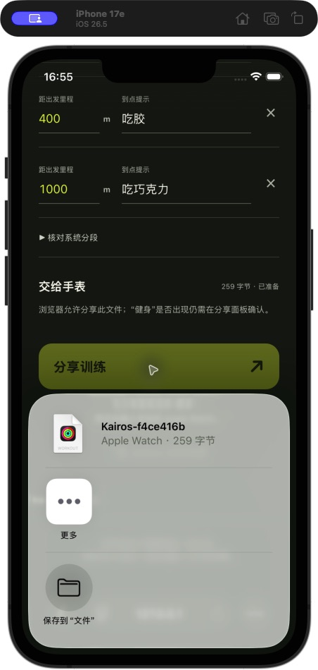
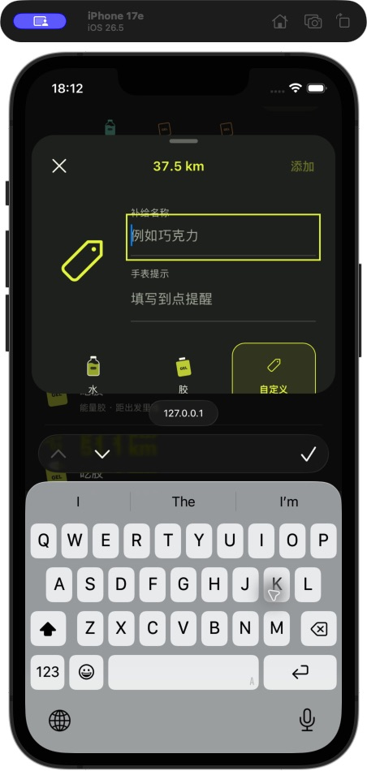
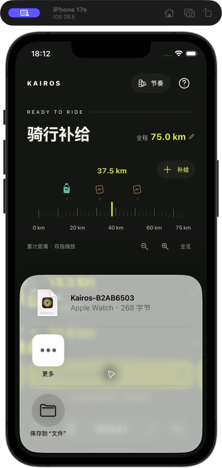
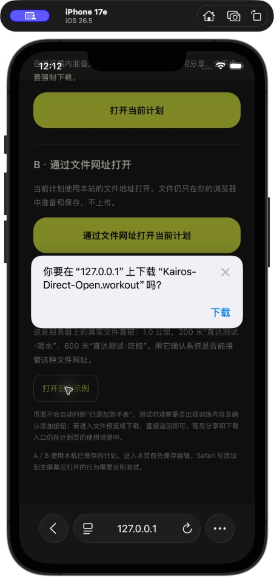
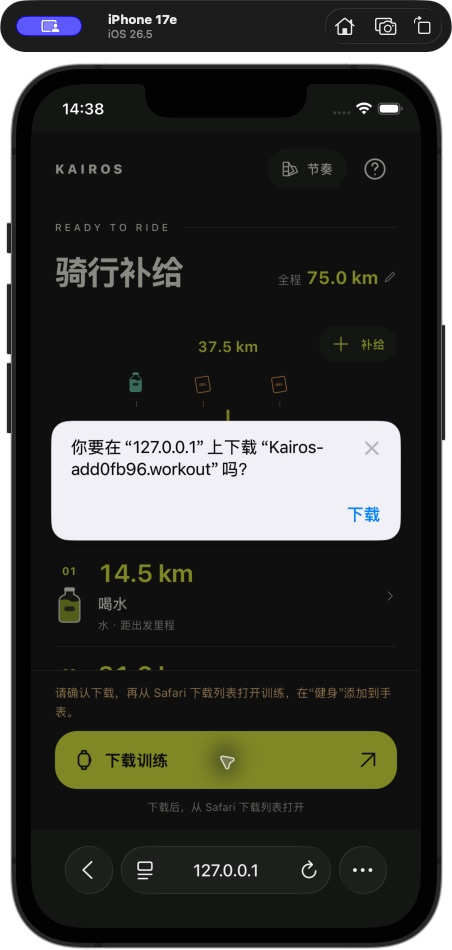
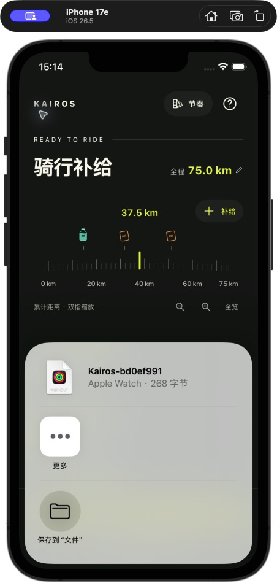
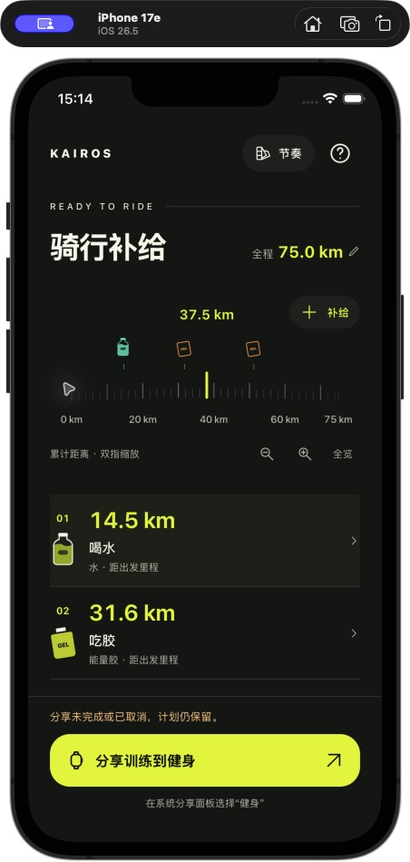
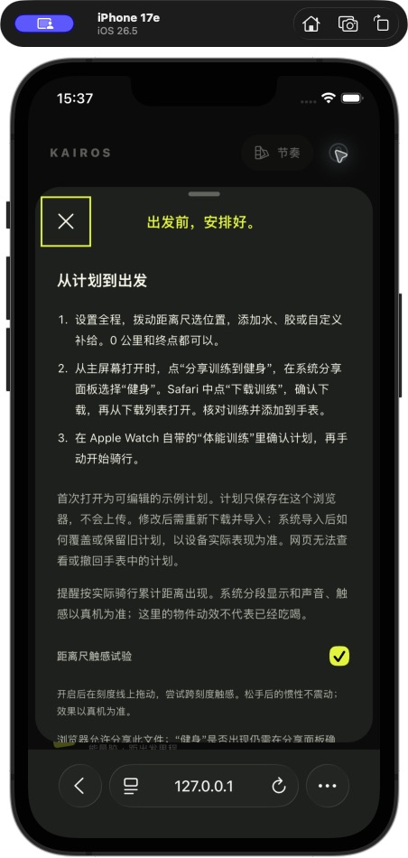
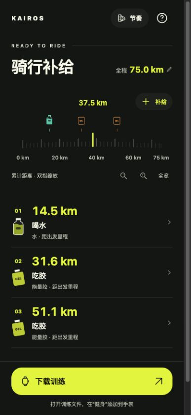

# 纯网页训练文件与界面验证

技术实验 [Issue #4](https://github.com/The-V-Factor/Kairos/issues/4) 已按用户验收通过 PR #6 合并；后续 [Issue #5](https://github.com/The-V-Factor/Kairos/issues/5) 对齐 App UI 并准备 Pages 发布。目标是不安装自有 iPhone / Watch App，不使用苹果开发者账号或重签，把网页计划作为数据文件交给系统“健身／体能训练”。

## 当前范围

当前已完成 B「节奏」网页编辑界面：全程融入标题，单层距离尺可浏览、缩放并显示已有补给；右上角加补给打开「补给主角」面板，水默认“喝水”，胶默认“吃胶”，自定义另填名称。支持 0 米和终点，单点增改删与撤销不改变其余点的位置；主页面浏览不直接修改已有点。

草稿保存在当前域名的 localStorage（kairos.web.plan.v1），包含计划和点位的稳定 ID、补给类型、自定义名称与累计位置；刷新恢复，取消面板不保存。首次打开为可编辑的 75 km 示例。无法读取旧草稿时不自动覆盖，帮助中可明确选择替换；保存失败会提示，并保留当前可分享计划。

本轮只迁移 B，不提供其他四套皮肤或系统排程历史；不伪造网页无法读取的设备状态。原有 iPhone 源码及 README 未改动。设计对照见 docs/design.md，发布步骤见 [Cloudflare Pages](cloudflare-pages.md)。

## 文件与分享

`web/workout.mjs` 使用无依赖 JavaScript 写入 protobuf 二进制，输出真正的 WorkoutPlan `.workout`；仅支持本产品需要的户外骑行、单次 work block、米制距离目标、开放末段和中文分段名称。字段参考 [DotnetWorkoutKit](https://github.com/changeforan/DotnetWorkoutKit/tree/0978caf9deafeafa3d371daab6f216376a0ec31f)，许可说明位于 `web/NOTICE.txt`。

这不是 Apple 公开承诺稳定的跨平台文件规范；必须用实际 Apple 解析器和目标设备验证。当前字段为 WorkoutPlan UUID 9、自定义训练 11、版本 1000=1、格式 1002=5。未用不支持的 JSON 形式替换二进制，也未将文件伪装成其他类型绕过分享限制。

累计里程转换复用原生语义：提醒放在到点后开始的下一段；0 米作为初始段名称，不生成零距离目标；尾段骑到计划全程，之后是开放完成段。精度也一致：公里量级按 100 m，不足一公里按 0.1 m 取整，取整重合要求合并。

页面随输入在内存中准备 File，后缀 `.workout`、MIME `application/octet-stream`。分享按钮点击后直接调用 `navigator.share({files: [file]})`，没有先下载、fetch 或异步生成；不额外分享 URL／文字。`canShare` 仅表示浏览器允许分享，不表示“健身”可用。

分享成功返回只说明交给系统，不表示导入或手表接收。取消保留表单；拒绝和不支持有明确状态。折叠的测试信息记录文件、环境和分享错误类别，不包含补给内容。下载按钮只作对照，不以下载成功替代直接分享验收。

修改及草稿恢复复用计划 UUID。导入时实际是覆盖还是新增、如何删除旧项，尚待真机记录；稳定 UUID 不等于系统一定覆盖旧导入项。

## 静态托管

当前计算和文件生成都在浏览器，无接口、账号、D1、配对码或服务端计算。**优先用 Cloudflare Pages 静态托管**；已有 Worker 不需要为了这个实验被覆盖。

Pages＋D1 并不意味着浏览器直连数据库。未来需要持久化时可用 Pages Functions → D1，或 Pages 静态 → 独立 Worker → D1；绑定与凭据留在服务端。Pages Functions 本身使用 Workers 运行时。域名／线路的可达性应实测，不能从产品名称保证国内访问。

本次没有创建 Cloudflare 项目、连接数据库或执行远端部署。用户提供的 `kairos` Worker 后台地址只是候选资源，不是最终前端访问地址。需要先确定 Pages 项目和可访问的 HTTPS 域名，再取得明确部署授权。

## 本机运行与打包

网页无 npm 依赖，Node.js 22 可运行测试与打包；Python 3 可提供本机静态预览：

```sh
rtk proxy python3 -m http.server 8787 --bind 127.0.0.1 --directory web
rtk proxy node --test web/test/*.test.mjs
rtk proxy node tools/package-web.mjs
```

打包工具输出一个新建的 `/private/tmp/kairos-file-share-<时间>/` 目录，当前包含 11 个发布文件，排除测试和工具源码。也可传入新目录，例如 Git 集成使用 `node tools/package-web.mjs dist`。预构建目录上传方式无需另执行构建；Git 集成的构建参数详见 Pages 文档。`_headers` 设置 CSP 和 `web-share=(self)` 等策略；保留该文件及 NOTICE。

`127.0.0.1` 是访问设备自身：Mac 和模拟器可用本机预览，真实 iPhone 不能用这个地址访问 Mac。局域网普通 HTTP 不满足 Web Share 安全环境要求，真机用实际 HTTPS 地址；不要通过忽略证书警告作为验证步骤。

## Apple 独立互操作验证

`tools/generate-workout-fixtures.mjs` 生成七种不同输入及 JavaScript 编码文件。开发用 `tools/verify-workout.swift` 使用 Apple WorkoutKit 解码，并和现有 `FuelPlan.workoutPlan` 产生的完整对象比较，包括 UUID、骑行类型、目标、单位和所有中文名称；还检查 Apple 重新编码后可再次读入。

这只是 macOS 开发工具，不是用户端 App，不安装程序到手机／手表、不申请排程权限，也不需要开发者账号。Apple Silicon Mac、macOS 15+ 和 Xcode SDK 下运行：

```sh
rtk proxy node tools/generate-workout-fixtures.mjs /private/tmp/kairos-workout-interop
rtk proxy swiftc -target arm64-apple-macos15.0 -module-cache-path /private/tmp/kairos-file-module-cache KairosCore/FuelPlan.swift KairosCore/PlanDistance.swift KairosCore/WorkoutPlanBuilder.swift tools/verify-workout.swift -o /private/tmp/kairos-verify-workout
rtk proxy /private/tmp/kairos-verify-workout /private/tmp/kairos-workout-interop
rtk proxy swift format lint --strict tools/verify-workout.swift
```

## #4 实验取得的证据（2026-11-10）

- 10 项 Node 行为测试通过：分段语义、删除保留绝对位置、出发／终点、尾段、精度、非法值、二进制、同步调用分享、取消和拒绝。
- 发布工具只打包 8 个静态文件，生成可供 Pages 上传的目录／压缩包，排除测试和工具源码。本地 Wrangler Pages 模拟器已解析 `_headers` 并返回 HTTP 200，CSP、`web-share=(self)` 和其他响应头可读取；不涉及远端部署。
- 七种 JS 文件全部通过真实 Apple WorkoutKit 精确对象比较：出发＋终点、出发单点、终点单点、尾段、小数米、公里取整、长中文及 emoji。
- 在桌面内嵌浏览器操作表单，验证自定义 75 km 计划、删除中间点保留 75 km 终点、新增点、未填完整禁止导出；下载的实际 263 字节文件也用 Apple 框架核对，与页面 0／25／70／75 km 输入相等。合计八份文件通过互操作验证。
- iPhone 17e **模拟器**、iOS 26.5 系统 Safari：打开本地页面，直接点击“分享训练”弹出系统分享面板，显示训练文件图标及“Apple Watch · 259 字节”，没有先保存到文件。取消后表单保留且不宣称导入成功。
- 同一模拟器的“更多”App 列表为空，无法验证“健身”目标及实际 Watch 导入。
- 桌面内嵌浏览器 `canShare` 返回 true，但实际分享返回 `NotAllowedError`（点击激活为 true）。这是真实环境限制，不将其记录为成功；系统 Safari 模拟器测试单独记录。



## #5 界面与发布包验证（2026-11-10）

- `rtk proxy node --test web/test/*.test.mjs`：17 项通过。新增验证草稿读写保留 ID／类型／自定义名、单点移动及删除撤销、出发与终点、空草稿、缩短全程边界、取整重合、异常存储保留原文、距离解析和刻度间隔。
- 402×874 及 320×740 浏览器布局检查：首页、默认提示、手改后切类型不覆盖、取消不保存；新增 0 公里及 75 公里终点香蕉，修改中点 31.6→45 公里，删除与撤销，不移动其他点；刷新恢复全部输入。测试后移除临时点，恢复原示例。
- 实际水平拖动已露出红色删除按钮，再点按删除及撤销通过；没有整段滑动直接删除。缩放按钮保留精确游标，程序定位不受整数像素量化影响。
- 新网页实际下载的 286 字节文件，经 Apple WorkoutKit 与原生对象完整比较通过，含 0／14.5／45／51.1／75 km 及终点自定义“吃香蕉”。合计 9 个互操作案例通过；编码器协议未改。
- iPhone 17e / iOS 26.5 模拟器系统 Safari，在本地 Pages 发布包检查首页、默认类型不自动唤键盘、自定义软键盘与表单可见性；修正视口平移造成的键盘遮挡，关闭后背景恢复。
- 同一模拟器实际点击新版“分享训练到健身”，直接打开 .workout 分享面板，显示“Apple Watch · 268 字节”；取消后保留计划并明确显示未完成，未虚报接收成功。
- `node tools/package-web.mjs dist` 本机首次构建通过，最终发布包只含 11 个文件且 ZIP 完整性检查通过。Wrangler 本地 Pages 模拟器返回 200，CSP、web-share 权限及 JS 内容类型可核对；没有 Functions 或 D1，也未创建远端资源。
- 真实手指连续拖动／双指缩放、减少动态效果与极大字号的设备验收，以及真实 Watch 导入与提醒仍待测，不把鼠标／模拟器结果当成真机手感。

| Safari 模拟器软键盘 | 新版直接系统分享 |
| --- | --- |
|  |  |

## 用户线上验收（2026-11-11）

用户提供部署地址 https://kairos-2rm.pages.dev/，并确认“手机能打开网页，并且下载训练内容”，据此同意 #5 本阶段验收并要求代码提交合并。此处记录用户提供的真机结果，不把下载成功当成直接分享、“健身”导入或 Watch 骑行提醒通过。手机／系统版本、线上部署提交及资源一致性未核验；这些设备验证仍保留为后续边界。

## 真机门槛（尚未通过）

1. 真实 iPhone Safari 打开待确认的 HTTPS 测试地址，填写实际设备与系统版本。
2. 点“分享训练”，确认不经过手动下载即出现分享面板。
3. 确认“健身”目标出现，系统预览的户外骑行、中文分段名称与页面一致，确认添加到配对 Apple Watch。
4. 在系统“体能训练”找到并启动，分别记录到点文字、声音／触感、0 米、终点之后继续骑行。
5. 修改后重新分享，观察覆盖／新增及旧项删除行为；没有回执的状态不推定成功。

若直接分享不支持或没有“健身”目标，保存本次测试信息与截图。可下载文件作独立对照，但不能把备用路径当成主流程通过，更不能擅自回到自有原生 App 方案。

## 直接进入健身预览的实验（2026-11-11）

用户要求进一步省掉寻找文件及选择分享目标：点击网页按钮后直接展示**这份计划**的健身预览，用户只作系统添加确认。下载确认、分享菜单及只打开健身首页均不算通过。跟踪 [Issue #8](https://github.com/The-V-Factor/Kairos/issues/8)，使用独立测试分支，不合并生产 main；Pages 预览与真机结果记录在 Issue。

从计划页使用说明的「试试直接打开健身」进入 `/open/`，或直接访问该路径。页面读取同域名已保存草稿；未保存的编辑先在计划页保存。此页不写入或覆盖草稿，不变更二进制编码和主分享按钮。

| 路径 | 具体操作 | iOS 26.5 模拟器 Safari、本地 HTTP 的结果 |
| --- | --- | --- |
| A：当前计划 File URL | 预先生成 File，以 Blob URL 导航；不使用 download 属性或 share() | 弹出下载确认，名称 Unknown；未直达健身 |
| B：当前计划的本机文件地址 | `/open/` 范围的 Service Worker 从 Cache Storage 返回当前计划，提供 `.workout` 路径和 inline 文件名 | 弹出下载确认，正确识别 `.workout` 文件名；未直达健身 |
| C：服务器静态文件直链 | 打开 `assets/direct-open.workout`，响应含 octet-stream 类型、inline 文件名、no-store | 弹出下载确认；未直达健身 |

固定控制文件为 1 km 户外骑行，200 m「直达测试·喝水」、600 m「直达测试·吃胶」；只用于文件打开对照，不限制用户计划。源码输入保存在 `web/test/direct-open-plan.json`，修改时使用现有 encodeWorkout 重新生成对应二进制，测试会检查二者一致。Apple WorkoutKit 已解析该文件并与原生 WorkoutPlan 完整比对，257 字节，合计 10 个互操作案例通过。

读取测试模拟器的系统 Fitness.app 应用包元数据，确认其声明文件类型 `com.apple.workout`、扩展名 `workout`，且 document handler 为 Owner；没有注册专用 MIME 字符串，因此没有编造 MIME 类型绕过系统。URL scheme 声明包含 fitnessapp，但未查到可接受我们计划数据的可靠入口，实验没有用仅打开训练首页代替导入。

浏览器 Service Worker 仅注册于 `/open/`，只拦截同源 GET 的测试 `.workout` 文件；缓存缺项返回明确 404，不向服务器回退取计划。只保留一份最新测试文件在浏览器，不读健康数据、不上传内容、不接管其他页面、第三方网址或写入请求。若健身自身随后联网取这个本机文件地址，它无法读取浏览器缓存，所以保留 C 的真实服务器文件作独立对照。

`node --test web/test/*.test.mjs` 21 项通过；新增测试覆盖静态文件一致性、本地响应字节及 inline 头、过期缓存 404 与范围隔离。Pages 本地模拟器已解析两条 header 规则，固定文件返回 200，Content-Disposition 为 inline。



**当前结论：此环境下三条路径均未实现直达，未达到交互验收标准。** 已保留实验入口供真实 HTTPS／iPhone、Safari／主屏幕模式分别复测；未把本地 HTTP 结果说成所有 iPhone 均不支持。真机复测使用 Issue #8 对应测试分支的 Pages 预览，不自动替换生产主流程。


## B 作为主入口（2026-11-11，Issue #8）

用户在真实 HTTPS 页面反馈 A 失败；B/C 仍有下载确认，但可以从 Safari 下载列表直接打开，不需要再寻找文件夹。未提供设备型号／系统版本，也未确认主屏幕模式。原始「网页一点直达健身预览」目标仍未达到；用户明确接受上述较短流程并选择 B。

首页「下载训练」提前把当前计划准备为同源 `/open/Kairos-<id>.workout` 地址，不在点击中等待异步生成。修改计划立即移除旧链接；串行替换缓存，只允许最新准备结果启用主操作。无效计划、删除动画、分享期间禁用。系统分享能力不影响文件地址；准备失败可在说明中分享或备用下载。

共享的 `file-address.mjs` 用于首页与实验页，浏览器 Worker 仍只控制 `/open/`、只返回本机缓存，不控制主页、不上传计划、不代表完整离线 PWA。缓存缺项提示回计划页刷新，设备导入与手表接收仍需用户确认。服务器不持有这些文件，复制文件网址到另一设备不支持获取计划。


本轮验证：26 项 Node 测试通过（含 Worker 激活等待、慢旧写入不会覆盖新计划、失败后恢复、不依赖 Web Share）。本地 Pages 发布包解析两条响应头规则。iPhone 17e / iOS 26.5 模拟器 Safari：首页主操作弹出正确 `Kairos-<id>.workout` 下载确认，已取消下载；不将此当作真实手表导入验证。内置浏览器能确认编辑后链接重新启用，但下载自动化两次超时，未拿到下载产物；以 Safari 下载确认和缓存字节测试作为本轮对应证据。




## 主屏幕模式改用系统分享（本地试验，2026-11-11）

用户报告：添加到主屏幕后，B 文件网址可以直接进入健身，但回来停在文件界面，没有返回计划页的方法。当前本地改动以 `navigator.standalone` 或 `display-mode: standalone` 识别主屏幕模式：主操作改用已准备 File 的系统分享，不导航文件地址、不准备 B 缓存。Safari 保持 B 下载入口。PWA 不支持文件分享时明确禁用并给说明，不自动退回会卡住的文件导航。

验证：26 项 Node 回归通过，涵盖同步分享、取消、失败和不支持。iPhone 17e / iOS 26.5 模拟器，实际通过 Safari 添加 localhost:8792 到主屏幕并启动：PWA 显示「分享训练到健身」，点击弹出系统文件分享面板，识别为 Apple Watch 训练文件；取消后保留原 75 km 和三个补给点，仍可打开并取消编辑。Safari 显示原「下载训练」入口。模拟器分享目标列表没有健身，因此没有验证真实健身导入后返回，也没有真实触感设备证据。本轮未提交、推送或部署。

| PWA 文件分享 | 取消后计划仍可继续编辑 |
| --- | --- |
|  |  |

### 触感演示源码调查（未接入）

调查版本：`samdenty/ios-vibrator-pro-max` 提交 `032cc0aed2b8097d7d5cd8e286fedd63d5e85d11`。以下为源码事实与解释，不能替代真实 iPhone 触感测试：

- [time-picker.tsx](https://github.com/samdenty/ios-vibrator-pro-max/blob/032cc0aed2b8097d7d5cd8e286fedd63d5e85d11/demo/src/components/time-picker.tsx)：以 `Math.round(-y / 52)` 决定索引，索引变化请求 40 ms 震动。因此移动半格便改变索引，无需下个数字到达中心；松手后的 spring 动画也继续请求触感，没有按拖动状态过滤。快速漏震的具体原因没有真机追踪，不能说仅由该公式造成。
- [slide-to-unlock.tsx](https://github.com/samdenty/ios-vibrator-pro-max/blob/032cc0aed2b8097d7d5cd8e286fedd63d5e85d11/demo/src/components/slide-to-unlock.tsx)：按进度多次请求震动，间隔从约 20% 缩小至终点附近约 1%，每次 10–20 ms。不是解锁完成时单次反馈；慢拖有多次触感符合此设计。代码注释写开始约 5%，与公式不同，以公式为准。
- [elastic-slider.tsx](https://github.com/samdenty/ios-vibrator-pro-max/blob/032cc0aed2b8097d7d5cd8e286fedd63d5e85d11/demo/src/components/elastic-slider.tsx)：页面称 Haptic slider；按原始手指位置跨过画出的刻度边界触发 20 ms，与数值四舍五入分离；按下也请求 20 ms。这更符合尺上实际刻度和触感同步的目标。
- [movable.ts](https://github.com/samdenty/ios-vibrator-pro-max/blob/032cc0aed2b8097d7d5cd8e286fedd63d5e85d11/src/methods/click-passthrough/movable.ts)：触感窗口内不断随 pointermove 翻转隐藏开关方向，并覆盖 pointer capture。每次 vibrate 请求不等于系统承诺的一次物理触感。由此推断，慢拖的窗口内多个原生变化可能出现多次触感，快拖或松手后可能漏触感。

结论：不把整库接入当前原生惯性滚动距离尺。若后续实验，应按实际跨刻度触发、静止不重复、快速滑动不排队补震，并分别验证拖动、惯性与双指缩放。系统触感送达仍需真机判断。


## Issue #10：距离尺触感试验实现（2026-11-11）

触感入口位于「使用说明 → 距离尺触感试验」，默认关闭，仅本次页面打开有效。使用 Haptic slider 的实际跨刻度语义，与显示数值四舍五入分开；慢拖到刻度才请求、静止不重复、40 ms 内快速跨格丢弃额外请求，不排队补震。

`haptics.mjs` 局部实现：支持标准振动 API 的浏览器在原生拖动中请求反馈；iOS 原生 switch 路径只在距离尺的刻度轨道覆盖真实手势，使用一次方向切换请求一次跨格反馈，不创建持续脉冲窗口，不引入整页 polyfill。没有重写 document.body、navigator、其他控件事件或 pointer capture，没有后台弹窗或主线程阻塞。仅在该试验路径内驱动横向拖动与衰减惯性，纵向手势转为页面滚动，双指触控停止当前触感并交给原有缩放处理。关闭时移除覆盖、停止惯性并恢复原生滚动；移动标记、改总距、缩放、开面板与隐藏页面也取消触感状态。没有复制第三方库；机制参考前述固定版本源码。

验证：32 项 Node 测试通过，新增 6 项覆盖实际边界、快速不补发、正反向与非整数终点、缩放／范围变化、局部原生拖动／关闭清理及双指／取消清理。iOS 26.5 / iPhone 17e 模拟器检查了开关可启用、缩放、取消补给编辑、关闭试验后全览；浏览器检查了普通下载入口、开关、键盘浏览及缩放，无 console error。原生模拟器自动拖动没有稳定改变读数，不作为手势或触感通过证据。多指真实手势、震动节奏及健身导入后返回仍待真实 iPhone 验证。



PWA 分享代码与前述取消返回证据一同纳入 #10；编码协议与草稿数据格式不变。用户已授权本次提交、合并与部署，真实触感和完整健身往返结果继续在 #10 跟踪，不宣称已通过。


## 真机反馈后的主入口调整（2026-11-11）

用户确认原「备用下载」体验最好。将这条已验证路径提升为首页「下载训练」：继续使用准备好的 File、Blob URL 和带 download 属性的链接，不改变文件字节、文件名及 URL 回收时机。Safari 与主屏幕模式统一此入口，系统分享留在说明中，B 文件网址保留在打开方式对照实验页；主页不再等待 Service Worker 地址准备。下载前停止局部触感手势。

用户另确认「快速移动不震动」发生在松手后的惯性滑动，并非手指按着快拖。当前明确在 pointerup 后结束 TickFeedback，惯性帧只移动刻度。iPhone 的局部 switch 路径依赖真实触摸，不能简单地在惯性动画内重复调用标准 vibration API 或模拟 click 来可靠获得反馈；本轮不修改该机制，不宣称已修复惯性震动。

WebKit 当前 [CheckboxInputType.cpp](https://github.com/WebKit/WebKit/blob/main/Source/WebCore/html/CheckboxInputType.cpp) 的 handleTouchEvent 在 touchend 停止触控计时，触控跟踪依赖 trusted event；[相关修复 PR #65327](https://github.com/WebKit/WebKit/pull/65327) 明确限制脚本点击 label 触发触感。公开开源 polyfill 的拖动样例仍依赖真实手势，不是惯性触感的可靠方案。

本地 32 项 Node 回归通过；17 文件发布包与源码一致、语法与 diff 检查通过。浏览器检查了主按钮可用、说明与入口一致，无 console error；本轮未重复导入真实手表。提交及部署状态见 Issue #10。


